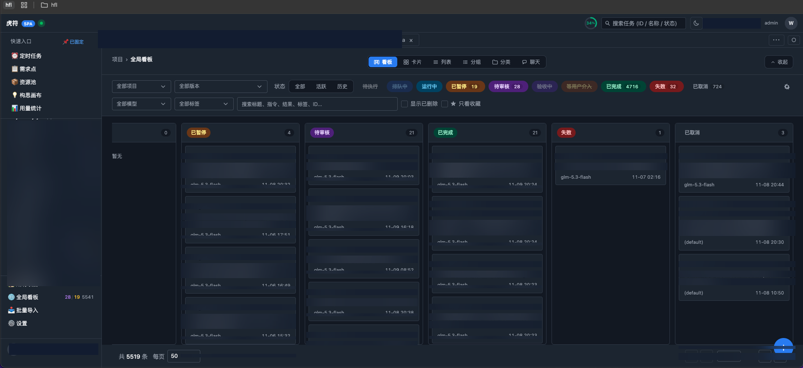
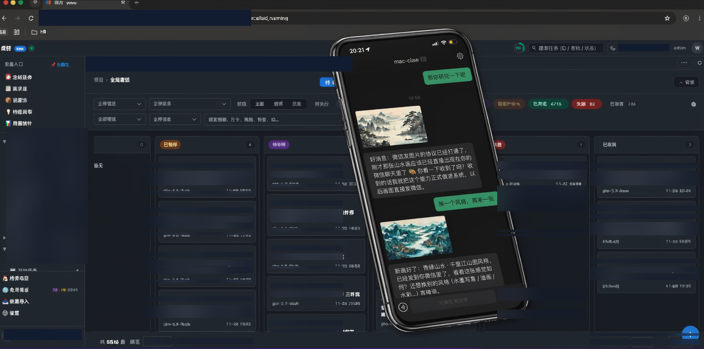
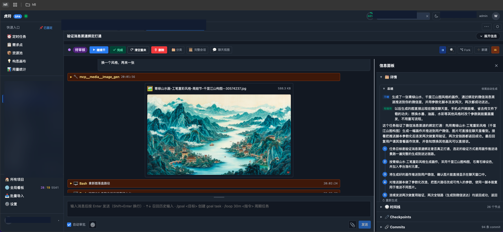
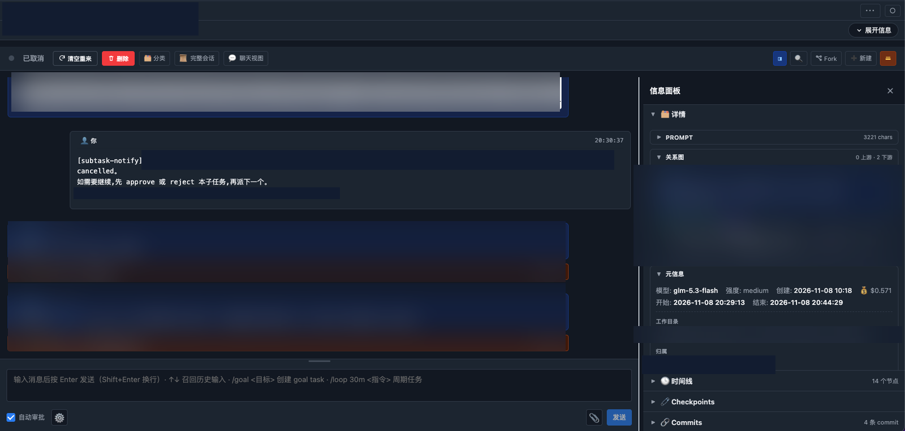
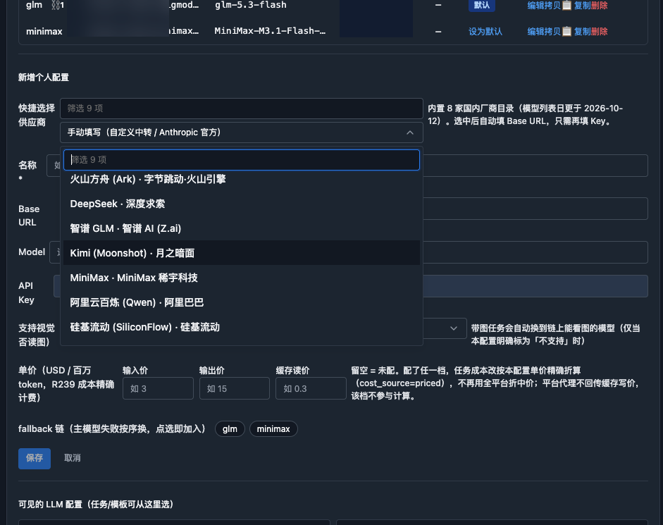

<div align="center">

# 提调 · Tidiao

### Dispatch Claude Code agents from your phone. Watch them work. Approve from anywhere.

**一句话派活，AI 在后台干活，你在手机上验收。**

[](LICENSE)
[](https://github.com/wyyxdgm/Tidiao/releases)
[](https://ghcr.io/wyyxdgm/tidiao)
[](https://nodejs.org)
[](https://github.com/wyyxdgm/Tidiao/stargazers)

**English** | [简体中文](README.zh-CN.md)

Self-hosted task orchestrator for Claude Code agents — web UI + Agent SDK + SQLite, multi-tenant & BYOK.
No inference cost from the platform. Your keys, your machine, your data.

[🚀 Quick Start](#-quick-start-5-minutes) · [🎬 See it in action](#-see-it-in-action) · [✨ Features](#-features) · [🤖 Model support](#-model-support) · [📖 Docs](docs/usage/README.md)

</div>

---



> **Global board:** queued / running / reviewing / paused / done / failed — drag, filter, search across all projects. Every task in the instance, one screen.

---

## 🤔 Why Tidiao?

You already use Claude Code. But running agents from a terminal doesn't scale:

| Pain | Tidiao |
|---|---|
| Terminal closed = agent stops, no queue | **Self-hosted server** — tasks queue, run, and survive restarts |
| No visibility into parallel agents | **Live kanban + SSE streaming** — watch every turn, tool call & commit |
| Review = scroll back through terminal logs | **Review loop** — approve / refine / fork / resume, with checkpoints |
| One model, one key, one vendor | **8 domestic providers + Anthropic** — pick per task, fallback chain, vision routing |
| Stuck at your desk to dispatch & check | **WeChat / Telegram / Web UI** — dispatch from your phone, get results back as images & files |
| Parent task waits for child manually | **Subtask auto-wake** — child finishes → parent is notified & continues |

> *Tidiao* (提调) = the Ming-era dispatch official. Dispatch = 授符 (issue the tally), verify = 合符 (match the two halves), agent = 虎贲 (the tally-runner).

---

## 🎬 See it in action

### 1. Dispatch from WeChat, get a painting back



> Send one message in WeChat: *“换个风格，再来一张”* — the agent generates a new 青绿山水 painting and sends it straight back to the chat. No desktop needed.

### 2. Watch it work, step by step



> Every tool call is visible: `mcp_media__image_gen` → generated file → Bash verification → auto-generated summary (干掉 / 有用 / 5-step recap). Fork, resume, or send a follow-up message and the agent keeps working.

### 3. Parent & child tasks wake each other automatically



> A child task finishes → `[subtask-notify]` wakes the parent with the result → parent decides: approve, reject, or dispatch the next child. The relationship graph (0 upstream · 2 downstream) shows the whole chain.

### 4. Swap models — just fill in one key



> Pick a provider from the built-in catalog (updated 2026-10-12) — Base URL is auto-filled, you only paste a key. Set a fallback chain (`glm → minimax`), vision-model routing, and per-task pricing in the same screen.

---

## ✨ Features

- 📱 **Multi-channel intake** — WeChat (personal account, iLink), Telegram, WeCom, webhook → auto-create tasks. Voice messages are transcribed into the task thread.
- 🗂️ **Kanban & boards** — card / list / chat / grouped views, drag-and-drop, global board across all projects, SSE live updates.
- ⚙️ **Full task lifecycle** — queued → running → reviewing → done, plus paused / failed / cancelled. Approve, refine, fork, resume, rewind via checkpoints.
- 🔗 **Parent–child orchestration** — dispatch downstream subtasks, auto-notify & wake the parent on completion, visual relationship graph.
- 🤖 **BYOK model catalog** — 8 domestic providers + Anthropic manual entry, encrypted keys (AES at rest), fallback chain, vision auto-routing, per-config pricing.
- 🕐 **Schedules** — cron / one-shot jobs (agent prompt or shell), anti-pileup guards, stuck-task diagnosis (`ao stuck`).
- 📋 **Projects, versions & wiki** — projects bound to repo `cwd`, per-project markdown wiki (`INDEX.md`), Feishu sheet sync, requirement entities.
- 🛠️ **Claude Code skills + CLI** — 8 `orchestrator-*` skills and a unified `scripts/ao` CLI so an agent can dispatch, query, monitor and diagnose tasks directly.
- 🔐 **Multi-tenant** — JWT auth, data isolated by owner, first registered user = admin. Bilingual UI (中文 / English).

---

## 🚀 Quick Start (5 minutes)

### Option A — Docker (recommended, no Node needed)

```bash
export JWT_SECRET=$(openssl rand -hex 32)
docker compose -f docker-compose.yml -f docker-compose.ghcr.yml up -d
# → http://localhost:3000
```

Image: `ghcr.io/wyyxdgm/tidiao` (`latest` tracks `main`, every `v*` tag gets a version tag).
Data lives in `./data` (SQLite) — back it up like any SQLite file.

### Option B — Local dev

```bash
git clone https://github.com/wyyxdgm/Tidiao.git
cd Tidiao
npm install
npm run build:spa    # build the Vue web UI into public/ (first time)
npm run dev          # → http://localhost:13000
```

Requirements: Node ≥ 20, git, and a Claude Code installation or any Anthropic-compatible API key.

### Then, 4 steps to your first task

1. **Register** at the URL above — the first user becomes admin.
2. **Add an LLM key** — Settings → pick a provider (Base URL auto-filled) → paste your key → Save.
3. **Create a Project** — point `cwd` at a git repo on this machine.
4. **Dispatch a task** — click `+`, write a prompt, hit *Create & Start*. Watch it stream live; approve or refine when it lands in *Reviewing*.

> **BYOK:** the orchestrator carries no inference cost of its own — you plug in your own keys; they are encrypted in SQLite.

### Drive it from Claude Code itself

```bash
bash scripts/ao help     # dispatch / chat / query / act / monitor / recall …
bash scripts/ao doctor   # self-check
```

Skills in `.claude/skills/orchestrator-*` are picked up automatically when you run `claude` from the repo root. Start with `orchestrator-onboarding` — see the [skill tree](docs/usage/00-skill-tree.md).

CLI auth: `export AO_TOKEN=<bearer from Settings → API Token>` (never expires), or `AO_EMAIL` + `AO_PASSWORD`. Default target `http://localhost:13000`; point `AO_BASE_URL` at a remote instance.

---

## 🤖 Model support

Built-in catalog (model list updated 2026-10-12) — select a provider, only the key is needed:

| Provider | Notes |
|---|---|
| 火山方舟 Ark (Volcengine) | ByteDance / Volcano Engine |
| DeepSeek · 深度求索 | |
| 智谱 GLM (Z.ai) | Zhipu AI |
| Kimi (Moonshot) · 月之暗面 | |
| MiniMax · 稀土科技 | |
| 阿里云百炼 Qwen (Alibaba) | |
| 硅基流动 SiliconFlow | |
| 手动填写 (Anthropic 官方 / 自定义中转) | Any Anthropic-compatible endpoint |

Per-config: fallback chain (main model fails → next in chain), vision-model auto-routing for image tasks, and optional per-million-token pricing for exact cost accounting (`cost_source=priced`).

---

## 🏗️ Architecture (30 seconds)

```
WeChat / Telegram / Web UI / CLI (scripts/ao)
                │
                ▼
        Next.js API + Vue SPA  (same server, :13000 / :3000)
                │
        ┌───────┴───────┐
        ▼               ▼
   Task Scheduler    SQLite (better-sqlite3)
   (FIFO + 3-layer   projects · tasks · checkpoints
    concurrency)     · schedules · wiki · users
        │
        ▼
   Claude Agent SDK  ──►  Claude Code / domestic models (BYOK)
        │
        └── MCP tools (e.g. image generation) → deliver back to chat
```

Full details: [architecture](docs/architecture.md) · [API routes](docs/api-routes.md) · [Agent SDK patterns](docs/agent-sdk-patterns.md)

---

## 📖 Docs

| Doc | Content |
|---|---|
| [docs/usage/](docs/usage/README.md) | User manual (22 chapters by module) |
| [docs/usage/feature-map.md](docs/usage/feature-map.md) | Feature map — what the platform can do, in one tree |
| [docs/architecture.md](docs/architecture.md) | Architecture + data model |
| [docs/api-routes.md](docs/api-routes.md) | API routes reference |
| [docs/workflow.md](docs/workflow.md) | Delivery lifecycle (task types, review loop) |

---

## ❓ FAQ

**Do I need a Claude subscription?**
No. Bring your own key — Anthropic official or any Anthropic-compatible provider (Ark, GLM, Kimi, MiniMax, Qwen, DeepSeek, SiliconFlow…). Keys are AES-encrypted at rest.

**Is my data / code sent anywhere?**
No. Self-hosted: SQLite on your machine, no telemetry from the platform. Agent calls go directly from your server to the model provider you configured.

**What does it cost to run?**
The platform itself is free (Apache-2.0). You only pay your model provider for the tokens your agents use.

**Windows?**
Use Docker (Option A) or WSL. The Docker image is the most tested path.

**Why is the Docker image ~1.9 GB?**
Known limitation of v0.2.0 — it ships the full production dependency tree (Agent SDK + native binaries). Slimming is tracked as separate work; functionality is unaffected.

---

## 📌 Status

First public release v0.1.0 (2026-11-06); v0.2.0 (2026-11-09) added Docker distribution + Claude Code skills/CLI. Single-maintainer project — issues are read, PRs are not accepted for now. Development happens in the open.

See [CHANGELOG.md](CHANGELOG.md) for release notes.

## ⭐ Star History

If Tidiao saves you a terminal session, a star helps others find it.

## 📄 License

[Apache-2.0](LICENSE)
