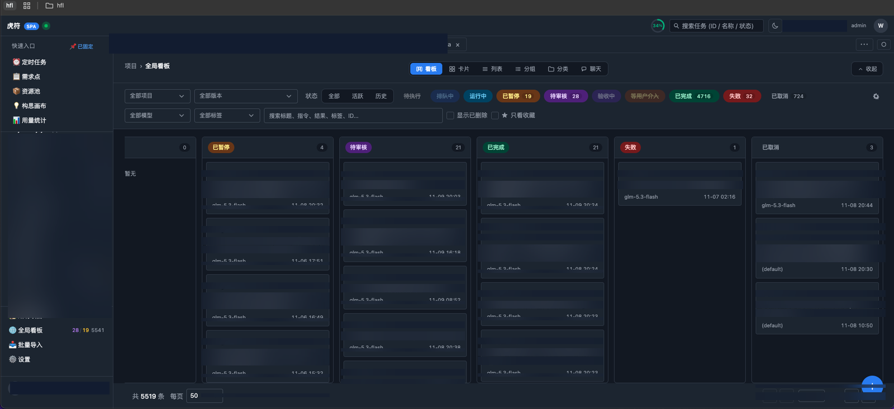
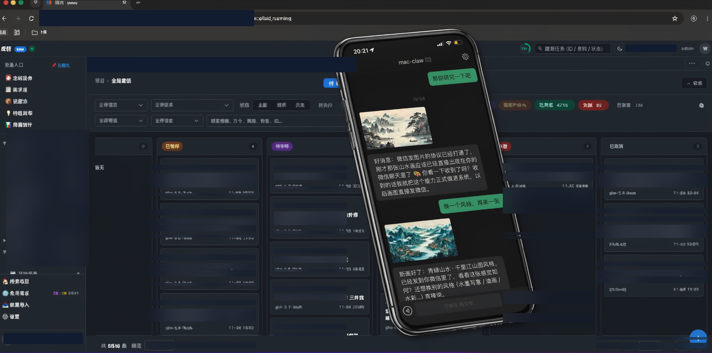
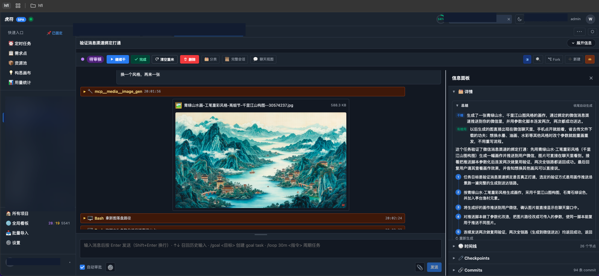
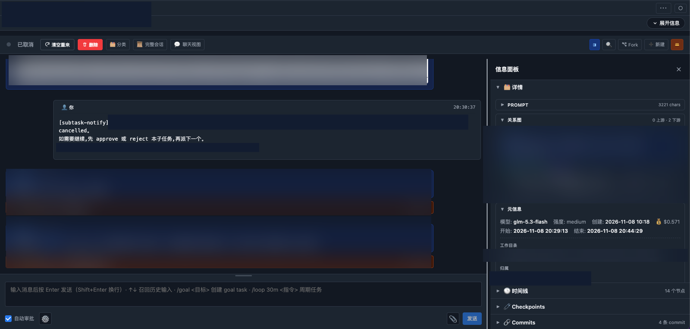
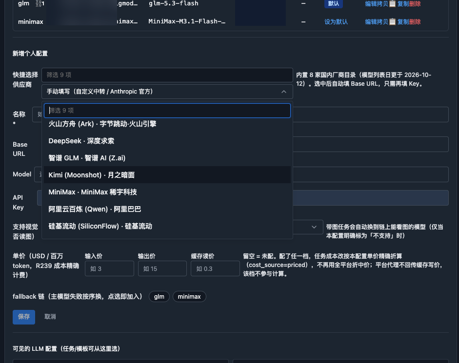

<div align="center">

# 提调 · Tidiao

### 一句话派活，AI 在后台干活，你在手机上验收。

**Dispatch Claude Code agents from your phone. Watch them work. Approve from anywhere.**

[](LICENSE)
[](https://github.com/wyyxdgm/Tidiao/releases)
[](https://ghcr.io/wyyxdgm/tidiao)
[](https://nodejs.org)
[](https://github.com/wyyxdgm/Tidiao/stargazers)

[English](README.md) | **简体中文**

自托管的 Claude Code Agent 任务编排平台 — Web UI + Agent SDK + SQLite，多租户、BYOK。
平台本身不收推理费用：你的 Key、你的机器、你的数据。

[🚀 快速开始](#-快速开始5-分钟) · [🎬 看它干活](#-看它干活) · [✨ 功能](#-功能) · [🤖 模型支持](#-模型支持) · [📖 文档](docs/usage/README.md)

</div>

---



> **全局看板：** 排队中 / 运行中 / 待审核 / 已暂停 / 已完成 / 失败 — 拖拽、筛选、搜索，跨项目一屏看全。

---

## 🤔 为什么用提调？

你已经在用 Claude Code 了。但在终端里跑 Agent，规模一大就撑不住：

| 痛点 | 提调 |
|---|---|
| 终端一关 Agent 就停，没有排队 | **自托管服务** — 任务排队、运行，重启不丢 |
| 并行跑的 Agent 看不见 | **实时看板 + SSE 直播** — 每一步输出、工具调用、commit 都看得见 |
| 验收要翻终端日志 | **审核闭环** — 通过 / 打回 / Fork / 续跑，带 Checkpoint |
| 只有一家模型、一个 Key | **8 家国内厂商 + Anthropic** — 按任务选模型、fallback 链、视觉路由 |
| 派活和验收必须守在电脑前 | **微信 / Telegram / Web** — 手机派活，结果以图片/文件发回 |
| 父任务要手动等子任务 | **子任务自动唤醒** — 子任务完成 → 父任务自动被唤醒继续 |

> *Tidiao*（提调）= 明代掌调度协调的官员。派发 = 授符，验收 = 合符，Agent = 虎贲。

---

## 🎬 看它干活

### 1. 微信派活，画作发回手机



> 在微信里发一句：*“换个风格，再来一张”* — Agent 生成一幅新的青绿山水画，直接发回聊天窗口。不用开电脑。

### 2. 每一步都在眼皮底下



> 每次工具调用都可见：`mcp_media__image_gen` → 生成文件 → Bash 验证 → 自动总结（干掉 / 有用 / 5 步复盘）。Fork、续跑，或直接留言改需求，Agent 继续干。

### 3. 父子任务自动互相唤醒



> 子任务完成 → `[subtask-notify]` 唤醒父任务并带上结果 → 父任务决定：通过、打回，或派下一个子任务。关系图（0 上游 · 2 下游）把整条链画得清清楚楚。

### 4. 换模型，只填一个 Key



> 从内置目录（2026-10-12 日更）选厂商 — Base URL 自动填好，你只需粘贴 Key。同一屏可设 fallback 链（`glm → minimax`）、视觉模型路由和按任务计价。

---

## ✨ 功能

- 📱 **多渠道接入** — 微信（个人号 iLink）、Telegram、企微、Webhook → 自动建任务；语音自动转文字进任务线程。
- 🗂️ **看板多视图** — 卡片 / 列表 / 聊天 / 分组，拖拽排序，全局看板跨项目，SSE 实时更新。
- ⚙️ **完整任务生命周期** — 排队 → 运行 → 待审核 → 完成，另有暂停 / 失败 / 取消。通过、打回、Fork、续跑、Checkpoint 回退。
- 🔗 **父子任务编排** — 派发下游子任务，子任务完成自动通知并唤醒父任务，可视化调用关系图。
- 🤖 **BYOK 模型目录** — 8 家国内厂商 + Anthropic 手填，Key AES 加密存储，fallback 链、视觉自动路由、按配置计价。
- 🕐 **定时任务** — cron / 一次性（Agent prompt 或 shell），防重派，`ao stuck` 诊断卡死任务。
- 📋 **项目 · 版本 · Wiki** — 项目绑仓库 `cwd`，项目 Wiki（`INDEX.md`），飞书表格同步，需求点实体。
- 🛠️ **Claude Code Skills + CLI** — 8 个 `orchestrator-*` skill + 统一 `scripts/ao` CLI，Agent 可直接派发、查询、监控、诊断。
- 🔐 **多租户** — JWT 鉴权，数据按 owner 隔离，首个注册用户 = admin。中英文双语 UI。

---

## 🚀 快速开始（5 分钟）

### 方式 A — Docker（推荐，无需 Node）

```bash
export JWT_SECRET=$(openssl rand -hex 32)
docker compose -f docker-compose.yml -f docker-compose.ghcr.yml up -d
# → http://localhost:3000
```

镜像：`ghcr.io/wyyxdgm/tidiao`（`latest` 跟 main，每个 `v*` tag 有对应版本）。
数据在 `./data`（SQLite），按普通 SQLite 文件备份即可。

### 方式 B — 本地开发

```bash
git clone https://github.com/wyyxdgm/Tidiao.git
cd Tidiao
npm install
npm run build:spa    # 首次构建 Vue 前端到 public/
npm run dev          # → http://localhost:13000
```

要求：Node ≥ 20、git，以及 Claude Code 或任意 Anthropic 兼容 API Key。

### 然后 4 步跑通第一个任务

1. **注册** — 打开上面的地址，第一个注册用户即 admin。
2. **加 LLM Key** — 设置 → 选厂商（Base URL 自动填）→ 粘贴 Key → 保存。
3. **建项目** — `cwd` 指向本机一个 git 仓库。
4. **派任务** — 点 `+`，写 prompt，点「创建并启动」。实时看直播，完成后在「待审核」里通过或打回。

> **BYOK：** 平台不收推理费用 — 你填自己的 Key，AES 加密存 SQLite。

### 让 Claude Code 自己操控平台

```bash
bash scripts/ao help     # 派发 / 聊天 / 查询 / 操作 / 监控 / 召回 …
bash scripts/ao doctor   # 自检
```

在仓库根目录跑 `claude` 时，`.claude/skills/orchestrator-*` 会自动被加载。从 `orchestrator-onboarding` 开始 — 看 [Skill 树](docs/usage/00-skill-tree.md)。

CLI 鉴权：`export AO_TOKEN=<设置 → API Token>`（永不过期），或 `AO_EMAIL` + `AO_PASSWORD`。默认目标 `http://localhost:13000`，远程实例改 `AO_BASE_URL`。

---

## 🤖 模型支持

内置目录（模型列表 2026-10-12 日更）— 选厂商，只需填 Key：

| 厂商 | 备注 |
|---|---|
| 火山方舟 Ark | 字节跳动 / 火山引擎 |
| DeepSeek · 深度求索 | |
| 智谱 GLM (Z.ai) | 智谱 AI |
| Kimi (Moonshot) · 月之暗面 | |
| MiniMax · 稀土科技 | |
| 阿里云百炼 Qwen | 阿里巴巴 |
| 硅基流动 SiliconFlow | |
| 手动填写（Anthropic 官方 / 自定义中转） | 任意 Anthropic 兼容端点 |

按配置可设：fallback 链（主模型失败自动换下一个）、带图任务自动切视觉模型、可选的每百万 token 单价（精确成本核算）。

---

## 🏗️ 架构（30 秒）

```
微信 / Telegram / Web UI / CLI (scripts/ao)
                │
                ▼
        Next.js API + Vue SPA（同服务，:13000 / :3000）
                │
        ┌───────┴───────┐
        ▼               ▼
   任务调度器         SQLite (better-sqlite3)
   (FIFO + 三层并发)  项目 · 任务 · Checkpoint
                      · 定时 · Wiki · 用户
        │
        ▼
   Claude Agent SDK ──► Claude Code / 国内模型（BYOK）
        │
        └── MCP 工具（如画图）→ 结果发回聊天窗口
```

详见：[架构](docs/architecture.md) · [API 路由](docs/api-routes.md) · [Agent SDK 模式](docs/agent-sdk-patterns.md)

---

## 📖 文档

| 文档 | 内容 |
|---|---|
| [docs/usage/](docs/usage/README.md) | 用户手册（22 章，按模块） |
| [docs/usage/feature-map.md](docs/usage/feature-map.md) | 功能地图 — 一棵树看全平台能干啥 |
| [docs/architecture.md](docs/architecture.md) | 架构 + 数据模型 |
| [docs/api-routes.md](docs/api-routes.md) | API 路由参考 |
| [docs/workflow.md](docs/workflow.md) | 交付生命周期（任务类型、审核闭环） |

---

## ❓ FAQ

**需要 Claude 订阅吗？**
不需要。BYOK — Anthropic 官方或任意兼容厂商（方舟、GLM、Kimi、MiniMax、Qwen、DeepSeek、硅基流动…）都可以。Key AES 加密存储。

**数据 / 代码会发到哪里？**
不会。自托管：SQLite 在你自己的机器上，平台无遥测。Agent 调用从你的服务器直连你配置的模型厂商。

**运行成本？**
平台本身免费（Apache-2.0）。你只付给模型厂商你 Agent 用掉的 token 费用。

**Windows 能用吗？**
用 Docker（方式 A）或 WSL。Docker 镜像是验证最多的路径。

**为什么 Docker 镜像约 1.9 GB？**
v0.2.0 已知限制 — 打包了完整生产依赖树（Agent SDK + 原生二进制）。瘦身是独立工作，功能不受影响。

---

## 📌 状态

v0.1.0 首次公开（2026-11-06）；v0.2.0（2026-11-09）新增 Docker 分发 + Claude Code Skills/CLI。单人维护 — Issue 会看，暂不接受 PR。开发在公开仓进行。

发布说明见 [CHANGELOG.md](CHANGELOG.md)。

## ⭐ Star History

如果提调帮你省了一个终端会话，一个 Star 能让更多人找到它。

## 📄 License

[Apache-2.0](LICENSE)
