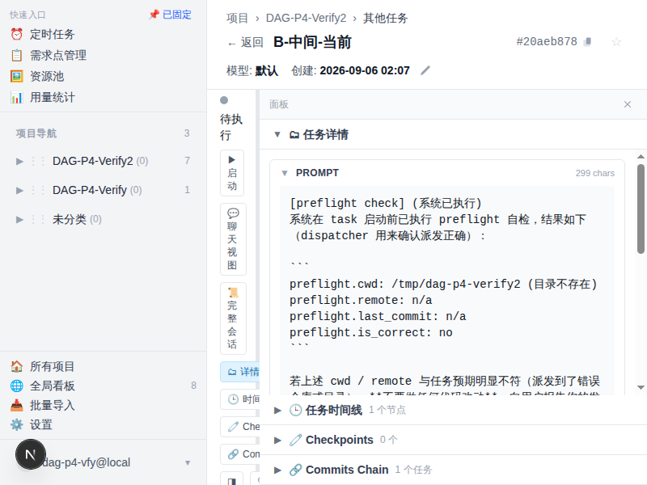

# 4. 任务详情页

> Agent 执行过程的实时交互中心：输出流、对话、审批、提问、检查点、分叉、回退、附件，全部在此完成。

## 概述

任务详情页（`/tasks/{id}`）是平台功能最丰富的页面。左侧为对话流和消息输入区，右侧为可折叠的面板区（详情、时间线、检查点、Commits）。页面通过 SSE 单例连接实时接收 agent 事件，支持工具审批、结构化问答、检查点分叉、附件上传等交互操作。所有操作按钮按任务状态动态显示。

---

### 功能点：实时输出（SSE 流）

- **是什么**：通过 Server-Sent Events 单例连接，实时展示 agent 的 token 级输出、完整消息、工具调用和工具结果。
- **怎么用**：打开任务详情页即自动连接 SSE。输出区域分为：
  - **流式文本**（`stream_delta`）：agent 正在生成的文本，带闪烁光标，逐 token 追加。
  - **完整消息**（`assistant_message`）：agent 一轮回复结束后的完整文本，以蓝色气泡渲染，支持 Markdown 渲染和文档路径链接化。
  - **工具调用卡片**（`tool_use`）：折叠状态显示摘要（如 `Edit: file.ts:3L`、`Bash: npm test`），点击展开查看完整输入参数。默认折叠。
  - **工具结果**（`tool_result`）：工具执行后的返回值。
  - **平台告警**（`warning`）：黄色小条 ⚠️，平台发现了 agent 自己看不见的问题时插入。目前一种：agent 派了后台 subagent 却要收尾（`Agent` 工具默认后台跑，subagent 活在 SDK 子进程里，本轮一收尾就被杀掉、报告拿不到）—— 平台会先注入指令让它等待汇总，最多两次；仍不听就放行并留这条告警。刷新后仍可见（从 events 表回放）。
- **注意**：
  - 同一任务的多个组件共享一个 EventSource 连接（模块级单例），避免浏览器 HTTP/1.1 并发名额耗尽。
  - 🆕 **R228 (2026-10-09) keep-alive 后台 tab 自动断流**：tab 切到后台（keep-alive deactivated）时 SSE 自动断开、切回时自动重连（重放历史，ETag 命中 304 时拉取代价可忽略）。背景：内网直连 `IP:13000` 是 HTTP/1.1，浏览器每域只有 6 个并发连接，后台 tab 的 SSE 不释放会把名额吃光，之后**所有**接口（含发消息）在浏览器排队无限 pending。走 `dao.example.com` 等 HTTPS 域名是 HTTP/2 多路复用，天然免疫。
  - 🆕 **R228 API 统一超时**：前端所有走 `api()` 封装的请求默认挂 30s 超时，超时后报「请求超时 (30s)」并可重试，不再无限转圈。调用方传了自定义 `signal` 则不覆盖。
  - 🆕 **R241 (2026-10-12) 跨 Chrome tab 自动挂起**：R228/R233 的断流只管 SPA 内部 tab 切换，管不到「同一浏览器开 N 个平台 tab」——每个 tab 一条 `/api/events`（侧栏在 keep-alive 外永不释放），N≥6 时新 tab 连 HTML 文档都拿不到连接、页面无限 pending（wiki 深链打不开的根因）。现在监听 `visibilitychange`：页面隐藏即挂起该 tab 全部长连接（`/api/events` + 任务流，含重连 timer），切回可见时自动重建。同一时刻只有**可见**的 tab 占连接，多 tab 场景名额不再耗尽；后台 tab 的数据新鲜度由 R165 条件轮询兜底。
  - 智能滚动：用户在底部时自动跟随新内容；向上滚动查看历史时显示"N 条新消息"提示，30 秒无操作后自动回到底部。
  - 显示模式三种切换：纯文本（隐藏工具调用）、标准（默认折叠）、详情（全部展开），通过工具栏图标切换，状态持久化到 localStorage。
  - 搜索功能：点击 🔍 图标打开搜索框，支持在消息文本、工具名、工具参数中搜索，匹配项高亮显示。
  - Session 过期时（401）自动关闭 SSE 连接，交由 AuthGuard 跳转登录页。
  - 🆕 **R256 (2026-11-03) 断线自动恢复 + 状态校准**（修「任务跑完了页面还显示运行中」）：此前 SSE 重连有 20 次上限（3s 间隔 ≈ 60 秒），公网隧道抖动超过一分钟就永久停更 —— 任务在服务端早已翻到 reviewing/cancelled，页面停在断线瞬间的「运行中」；且消息能靠 ETag 轮询兜底恢复、状态只走 SSE 推送没有任何兜底。现在：
    - **无限重连 + 指数退避**：断开后 3s 起每次失败翻倍，封顶 30s，永不放弃（只有登录过期 401 才关停）。重连成功后自动重置退避。
    - **断线恢复校准**：重连成功触发静默重拉任务详情（状态/花费/上下文）+ 消息历史（ETag 304 零传输），断线窗口内漏掉的状态变更和消息增量全部补齐。
    - **连接状态横幅**：重连中（显示退避轮次）或已断开时，消息流顶部显示横幅提示「实时流重连中/已断开」，不再无声卡死。
    - **非终态兜底轮询**：详情页打开期间每 45s 校准一次任务状态（终态停表），SSE 彻底失效也能在 45s 内自愈。
  - 🆕 **R256 服务端配套**：4 个 SSE 端点响应头加 `X-Accel-Buffering: no`，关闭 nginx 对流式响应的缓冲（修复 HTTP/1.1 客户端整段卡住不流式的问题；浏览器走 HTTP/2 本来不受影响，但 curl/代理链等 h1 客户端此前会拿到「45 秒后一次性吐出全部内容」的假流式）。

---

### 功能点：对话输入

- **是什么**：在页面底部输入框中向运行中的 agent 发送消息，或在任务终态时发消息自动激活恢复任务。
- **怎么用**：
  1. 在输入框中输入消息。
  2. 点击 **发送** 按钮或按回车。
  3. 消息以蓝色气泡显示在对话流中，agent 会收到并继续对话。
- **注意**：
  - 任务处于 `running` 状态时，消息直接推入运行中的 session。
  - 🆕 **R216 (2026-10-08) 插话打断**：agent 正在跑长 turn（如执行耗时工具）时发消息，平台会**主动打断当前 turn**（等价轻量暂停→恢复，session 不断），消息在下一个 turn 立即被处理——不再等到 turn 边界才被看到。连发多条会在同一轮**合并为一条**投递，agent 当一份指令读。
  - 🆕 **R56 复发修复 (2026-10-31) 插话附纠正注记**：打断时 SDK 会注入一段「The user doesn't want to proceed... STOP」英文系统文本，弱模型曾误读成「用户叫停」而回「收到，停」空等（R56）。现插话消息投递时**自动附一条中文 system-reminder 纠正注记**（全模型生效），告知这是投递消息的系统事件而非叫停，agent 应继续按任务目标推进。
  - 任务处于 `paused` 状态时，消息排队，恢复后自动发送。
  - 🆕 **排队中的任务允许发消息**（damo 2026-10-31）：任务处于 `pending`/`queued`（含从未启动过的）时发送消息不再报错——消息**先缓存**（transcript 里带「已排队」标记），等任务真正启动那一刻**一次性逐条投给 agent**（prompt 在前、缓存消息按到达顺序跟后）。注意排队任务**不会**因发消息被自动拉起：`pending` 等手动启动/cron 触发，`queued` 等调度槽位。
  - 任务处于终态（`completed`/`failed`/`cancelled`/`reviewing`/`rejected`）时，发送消息会自动激活任务回到 `queued` -> `running`，保留原有对话历史。
  - **首条 prompt 的时间显示**：任务 prompt（含 LLM fallback / 终态复活 fresh-start 重投的副本）在 transcript 里始终按**任务创建时间**显示与排序，不按重投时间——否则 prompt 会被排到几小时后发的 follow-up 消息后面（2026-10-07 taoke task 实测「第一条消息显示在最后」）。实现：`getSessionHistory` 命中 prompt 文本的首条 SDK user 消息统一以 `tasks.created_at` 计时（`src/lib/runtime/agent-runtime.ts`，回归测试 `get-session-history-order.test.ts`）。
  - **乐观插入 + SSE 流式回显**：点发送瞬间消息以临时气泡出现在对话流（带 `clientId`），不依赖 POST 返回或 SDK 落库。SSE 流推送的同名消息会按 text 去重不会重复渲染；POST 失败时按 `clientId` 撤回并还原输入框 + 附件。状态切换触发的 `loadHistory()` 合并按 `uuid`（带 `uuid` 的消息）/ `text`（optimistic 无 `uuid` 的用户消息）双重去重，避免「AI 一回复，我那条就被刷掉」的竞态（详见 `src/app/tasks/[id]/merge-history.ts`）。
  - 当 agent 有待回答的提问（`user_dialog_request`）时，输入框禁用，必须先回答提问。
  - 输入框左侧有 **自动审批** 勾选框，切换后立即持久化到数据库，**并实时推给正在运行的 session**（下一次工具调用即生效，两个方向都行，无需暂停/重启）。
  - **高级配置**（⚙️ 按钮）：发送时可覆盖模型、强度（effort）、最大轮次。模型选"默认"表示使用最新默认模型（忽略任务配置的快照）。运行中修改配置仅在下次恢复/重启时生效，本次发送仅推送消息。

---

### 功能点：工具审批

- **是什么**：agent 调用写入类工具（Write、Edit、Bash、NotebookEdit）时，需要人工批准才能执行。
- **怎么用**：
  1. 当 agent 请求审批时，页面顶部出现橙色审批横幅，显示工具名和完整输入参数（JSON）。
  2. 点击 **✅ 允许** 批准执行。
  3. 或在输入框中填写拒绝原因后点击 **❌ 拒绝**，拒绝原因会作为反馈返回给 agent。
- **注意**：
  - 只读工具（Read、Grep、Glob 等）始终自动通过，不触发审批。
  - 任务开启 **自动审批** 后，写入类工具也自动通过，不弹出审批横幅。
  - 自动审批开关**运行中切换即时生效**（开→关也生效：写入类工具一律经过 `canUseTool` 回调，不进 SDK 的 `allowedTools` 白名单）。已经在等待中的那一条审批不会被追认，需人工点一次，之后的才自动放行。
  - 审批请求同时出现在对话流中（作为工具调用卡片），方便上下文追溯。
  - 任务被取消时，等待中的审批请求自动拒绝。
  - `AskUserQuestion` 工具始终走提问流程，不受自动审批影响（它是交互式工具而非写入工具）。

---

### 功能点：提问与选择

- **是什么**：agent 通过 `AskUserQuestion` 工具向用户发起结构化问答，支持单选和多选。
- **怎么用**：
  1. agent 提问时，页面顶部出现紫色提问横幅，显示问题标题（header）、问题文本和选项列表。
  2. 每个选项显示标签和可选描述。
  3. 单选问题用 radio 按钮，多选问题用 checkbox。
  4. 选择答案后点击 **提交**，答案返回给 agent 继续执行。
  5. 可点击 **取消** 跳过提问（agent 会收到取消信号）。
- **注意**：
  - 提问期间无法发送普通消息（输入框禁用），必须先回答或取消提问。
  - 所有问题都需选择答案才能提交（不能留空）。
  - **stale 标记**：服务端重启后，历史中遗留的未回答提问会被重放显示，但带有"⚠ 服务端已重启，原问题可能已超时；提交可能无效"的警告。这是因为 SDK 的 Promise 在重启后已丢失。
  - 多选答案以逗号分隔提交。
  - 终态（completed/failed/cancelled）时自动清除所有待回答的提问。

---

### 功能点：检查点 Checkpoint

- **是什么**：agent 在输出中写入 `<checkpoint step=N summary="...">` 标记时，系统自动记录一个检查点，作为后续分叉的起点。checkpoint 流在面板上实时渲染成**进度流程图**——与任务收尾总结「核心细节」层（细节流程图）同口径，区别只是谁写的（前者 agent 实时自报，后者总结模型事后生成）。
- **怎么用**：
  1. agent 在 assistant 消息中输出 `<checkpoint step="1" summary="完成了数据库迁移" />` 格式的标记。default role 已内置该约定（damo 1007 起隐式口径）：**第 1 个实质步骤就写**（不再要求 ≥2 步），单步任务写 `step="final"`；dispatch prompt 仅在 fork 回退点关键任务上显式强调。
  2. 系统自动解析标记，在数据库中创建检查点记录。
  3. 右侧面板的 **🧷 Checkpoints** 标签页中显示所有检查点列表，包含 step 编号、时间、摘要和关联的 commit ID。
  4. 每个检查点节点有 **Fork from here** 按钮，可从该检查点分叉新任务。
  5. 也可手动添加检查点：点击"+ 手动添加 checkpoint"按钮，填写摘要即可。
  6. summary 按「流程图解」口径写（damo 1005 R197 拍板）：按处理顺序写「做了什么动作 → 得到什么结果」，覆盖改了什么文件 / 做了什么决策 / 拿到什么数据 / 有什么坑；summary 值内部不能出现英文双引号（要引用用「」）。
- **子状态 chip**：检查点停在等回复 / 有建议 / 需拍板 / 卡住时，agent 同行写 `status="..."`，面板渲染彩色 chip（蓝/紫/橙/红）。规范四态之外的**自然措辞「待拍板」「请选择」也按需拍板档识别**（damo 1007 加别名，不再落灰色 unknown）。
- **注意**：
  - 检查点是分叉（Fork）的前提 -- 没有 session 的任务无法分叉。
  - 检查点记录了当时的 transcript 切片，分叉时新 session 继承到该检查点为止的历史。
  - 检查点通过 SSE `checkpoint` 事件触发面板自动刷新，无需手动刷新页面。
  - Fork 任务会自动生成一个 step 0 检查点作为起点。
  - 任务收尾需要 damo 拍板 / 多选一时走 awaiting marker（见「等拍板」机制文档），与 checkpoint status 是「过程内联状态」vs「收尾结构化决策」的分工。

---

### 功能点：分叉 Fork

- **是什么**：从已有任务的 session 分叉出一个新任务，新任务继承父任务到某一点为止的全部对话历史，然后独立执行。
- **怎么用**：
  1. 任务处于有 session 的状态（paused/reviewing/rejected/completed/failed/cancelled）时，工具栏显示 **📋 Fork** 按钮。
  2. 点击 Fork 按钮弹出分叉表单。
  3. 填写可选字段：
     - **新任务标题**：留空使用默认标题（`Fork of: {父任务标题}`）。
     - **首个 prompt**：新任务的第一条指令，留空使用默认提示。
     - **新 cwd**：留空继承父任务工作目录，或填写新路径实现工作区隔离。
     - **最大轮次**：留空继承父任务设置（默认 200）。
     - **工具审核**：继承父任务 / 自动通过 / 需要逐个审核。
     - **压缩后继续**：勾选后 fork 的首个动作是压缩历史上下文为摘要（有额外成本，仅在父任务上下文较大时使用）。打开 Fork 弹窗时，若父任务上下文超过阈值（默认 100k tokens）会**自动勾选**此项，可手动取消。阈值在「系统设置 → Fork 自动压缩阈值」配置。
  4. 点击 **确认 Fork**，系统创建新 SDK session 和新任务，自动跳转到新任务页面。
  5. 也可从检查点分叉：在 Checkpoints 面板点击某个检查点的 **Fork from here** 按钮，同样弹出分叉表单（从该检查点位置分叉）。
  6. 也可**从任意一条 agent 消息分叉**：鼠标悬停在对话流中某条 🤖 消息上，右上角出现 **⑂ fork** 按钮，点击弹出同一张分叉表单（新 session 只继承到这条消息为止的历史）。
- **注意**：
  - Fork 创建的新任务自动进入 `paused` 状态后立即被调度器接管，以 `fork` 模式恢复执行（使用 `resume` 而非 `start`，因为 SDK session 已存在）。
  - 新任务继承父任务的 base_commit 作为自己的 base_commit。
  - Fork 任务的对话流中显示一条蓝色分隔线"🔀 Fork 起点 - 以下为本会话内容"，上方为继承自父任务的历史消息。
  - Fork 默认继承父任务的 `auto_approve` 设置，避免无人值守时卡在审批环节。
  - **⑂ fork 按钮只挂在 🤖 消息上**：工具调用卡片存的是 tool_use id 而非 transcript 消息 uuid，刚发出还没回读的用户消息则没有 uuid —— 两者传给 fork API 都会被"not found in parent session"挡掉，所以不提供入口。

---

### 功能点：文件回退 Rewind

- **是什么**：将工作目录中的文件状态回退到某条用户消息发送时的状态，用于撤销 agent 之后对文件的修改。
- **怎么用**：
  - 通过 API `POST /api/tasks/{id}/rewind` 调用，传入 `user_message_id` 和可选的 `dry_run` 参数。
  - `dry_run: true` 时仅预览哪些文件会被回退，不实际执行。
  - `dry_run: false`（或不传）时实际执行文件回退。
- **注意**：
  - 仅对运行中的任务有效（需要内存中的 ActiveSession）。
  - 底层调用 SDK 的 `queryInstance.rewindFiles()` 方法，基于 git checkpointing 机制恢复文件。
  - 文件变更列表可通过 `GET /api/tasks/{id}/changes` 获取，该接口优先使用 SDK 的 `rewindFiles(dryRun)` 获取实时状态，session 不在内存时回退到 DB 中的工具调用事件。
  - 该功能目前通过 API 提供，详情页 UI 中已预留状态变量但尚未完整渲染为可见面板。

---

### 功能点：附件上传

- **是什么**：在消息输入区上传文件或图片，附件会随消息一起发送给 agent。
- **怎么用**：
  1. 点击输入框右侧的 **📎** 按钮打开文件选择器。
  2. 选择一个或多个文件（支持多选）。
  3. 上传后，附件以标签形式显示在输入框上方（文件名 + 大小 + 移除按钮），同时在对话流中以独立条目展示。
  4. 图片附件显示缩略图，点击可在新标签页查看原图；其他文件显示文件图标。
  5. 发送消息时，附件 ID 随消息一起提交。
  6. 可在上传后、发送前点击附件标签的 **×** 移除。
- **注意**：
  - 附件存储在本地文件系统（`$ORCHESTRATOR_HOME/attachments/{taskId}/`），通过路径引用方式传递给 agent。
  - 上传通过 `POST /api/tasks/{id}/attachments`（multipart/form-data）。
  - 历史附件在页面加载时从 `GET /api/tasks/{id}/attachments` 获取并合入对话流。
  - 提问期间（pendingDialogs 非空时）附件上传按钮禁用。
  - 上传失败时显示错误提示，但不阻断其他文件的上传。
  - **单文件上限 10MB**（超了返回 413）。
  - **支持的类型**：图片（png/jpg/gif/webp/bmp/svg）、pdf、zip/tar/gz、纯文本类（txt/md/csv/log/json/jsonl/html/xml + 常见源码后缀）、Office 全家（xlsx/xls/docx/doc/pptx/ppt + xlsm/dot）、OpenDocument（odt/ods/odp）、rtf。
    ⚠️ **仍不含音视频** → 返回 `415 Unsupported file type`；即使放开白名单，agent 也读不了音视频的内容。Office 二进制同理（agent 读不到，仅供人查）。
  - **命令行上传要显式给类型**：`curl -F "file=@x.md"` 默认发 `application/octet-stream`。服务端会把它当"没说类型"并按扩展名兜底，但写成 `-F "file=@x.md;type=text/markdown"` 最稳。

---

### 功能点：会话转录页与导出

- **是什么**：`/transcript/{taskId}` 单独一页渲染这个 task 的**完整会话**（用户/助手正文 + 工具调用 + 工具返回 + thinking），并可下载成自包含的 Markdown 或机器可读的 jsonl。
- **怎么用**：
  - 入口：任务详情页状态栏的 **「📜 完整会话」**（新标签打开，不打断在跑的任务页）。
  - 页面：`/transcript/{taskId}`，顶部有元信息（模型/强度/花费/时长/session）+ **⬇ 下载 .md** + **⬇ 下载 .jsonl**。
  - API：`GET /api/tasks/{id}/transcript?format=markdown|jsonl|json&verbosity=summary|full`。
  - 命令行 / 跨机器搬运：用 `ao-session.sh export|import`，见 [11-cli](11-cli.md)。
- **一个必须知道的事实：完整会话不在数据库里**

  | 存在哪 | 装什么 | 同一个 task 实测 |
  |---|---|---|
  | `$ORCHESTRATOR_HOME/claude-config/projects/<cwd-slug>/<sessionId>.jsonl` | **完整会话**（正文 + thinking + tool_use + **tool_result**） | md `full` 21,553 B / `jsonl` 35,345 B |
  | DB 的 `events` 表 | **稀疏日志**（message / tool_use / status_change / cost / checkpoint） | 渲染出来 4,255 B，**tool_result 一条都没有** |

  所以：**看会话、导出会话、备份会话，都不能只看 DB**。页面和导出默认走 SDK jsonl；只有它读不到时（session 未分配 / 文件被清）才降级回 `events`，此时内容会明显变少。

- **注意**：
  - `verbosity` 默认 `summary`（丢 thinking、`tool_result` 截 2000 字，控制体积以便当附件传），页面渲染与两个下载按钮都用 `full`（逐字）。
  - `format=json` 是历史语义 = **raw events 数组**，不是完整会话；要机器可读的完整会话用 `format=jsonl`。
  - 备份：`backup-db.sh` 从 2026-08-12 起额外打包 `transcripts-*.tar.gz`，**换机只拷 DB = 丢完整会话**。见 [11-cli](11-cli.md) 的 backup-db.sh。

---

### 功能点：时间线与提交

- **是什么**：右侧面板包含时间线和 Commits 两个标签页，展示任务的状态变迁和 git 提交信息。
- **怎么用**：
  - **🕒 时间线**：展示任务状态变迁序列（如 pending -> running -> reviewing -> completed），包含每次状态切换的时间、来源/目标状态、持续时长。初始状态标记为 `is_initial`。
  - **🔗 Commits (R113, 2026-09-07)**：以 **git log 风格**展示本任务及所有从本任务 fork 派生的任务的 commit 记录。每条 commit 显示短 hash（commit_id[0:7]）、描述（desc）、提交时间；**点击展开查看变更文件清单（files 数组）**。
- **注意**：
  - 时间线在 SSE `status_change` 事件触发时自动刷新。
  - Commits 面板在状态变化时刷新，显示整个 fork 家族的 commit 关系。
  - **数据采集（marker + 自动收集双轨）**：
    - **marker 声明（R113）**：agent 在输出里写 `<git commit-id="abc" desc="..." files="a.ts,b.ts"/>`，runtime 解析后写 `task_commits` 表（带文件清单，归属最精确）。
    - **自动收集（R158，2026-09-26）**：agent 退出时跑 `git log base..head --no-merges` 兜底收集未声明的 commit（`INSERT OR IGNORE`，不覆盖 marker 数据）。damo 已拍板推翻 R113「不主动跑 git log」原则（cwd 是用户项目目录，其他面板早就在跑）。
    - **R228 增量语义（2026-10-09）**：自动收集带 `--since` 时间下界（上次收集终点 = 旧 `head_commit` 的提交时刻，无则退 task 创建时刻），并把收集窗口压回本 task 会话增量；同一 commit 已被其他 task 认领时**先到先得跳过**——修掉共享仓库多任务并发时「区间互认」（实测一条 commit 曾被 9 个 task 认领、R87 面板显示 66 条其中 80+ 是别人的）。
    - **存量清洗**：内部维护脚本，未随开源版提供（重复认领可手动核对 `tasks` 表 commit 记录）。
  - 派生 task 拓扑（fork 家族）放在面板头部一条**可折叠提示**里——主体是 commit log，fork 关系是元数据。
  - **agent 未声明 git 提交时**：面板显示提示文案 + base→head 区间（如 `base abc1234 → head def5678`），让用户知道「这个 task 改了哪些 commit 但 agent 没记录」。
  - `base_commit` 是任务启动时 cwd 的 git HEAD 快照；`head_commit` 是任务结束时的 git HEAD。
  - **与 Checkpoints 面板的边界**：Checkpoints 关注任务**进度节点**（agent 显式声明的关键里程碑）；Commits 关注**代码变更历史**（git log）。两面板并存不冲突。
  - 检查点可关联 commit ID，在检查点列表中以短 hash 显示（沿用历史行为）。

---

### 功能点：提示音

- **是什么**：关键事件发生时播放提示音，提醒用户需要操作或任务状态变化。
- **怎么用**：
  - 提示音在以下事件触发（默认开关状态）：
    - **工具审批请求**（`tool_approval`）- 默认开
    - **Agent 提问**（`user_dialog`）- 默认开
    - **待审核**（`reviewing`）- 默认开
    - **任务失败**（`failed`）- 默认开
    - **任务暂停**（`paused`）- 默认关
    - **排队中**（`queued`）- 默认关
    - **任务取消**（`cancelled`）- 默认关
  - 在设置页（`/settings`）可配置总开关和每个事件的提示音开关，配置存储在 localStorage。
- **注意**：
  - 人为手动暂停/取消时不响铃（用户正在操作页面，无需提醒）；自动暂停/取消（如超时）时响铃。
  - 提示音为纯客户端行为，服务端不参与。
  - 总开关关闭时全部静音。

---

### 功能点：状态操作按钮

- **是什么**：根据任务当前状态，在状态栏旁动态显示对应的操作按钮。
- **怎么用**：各状态可用按钮如下：

  | 状态 | 按钮 | 说明 |
  |------|------|------|
  | pending（待执行） | ▶ 启动 | 将任务加入调度队列 |
  | running（运行中） | ⏸ 暂停 / ✕ 取消 | 暂停保留 session 可恢复；取消终止任务 |
  | paused（已暂停） | ▶ 恢复执行 | 弹出恢复选项弹窗，可调整自动审批和最大轮次后恢复 |
  | reviewing（待审核） | 驳回 / ✅ 完成 / 🔄 清空重来 | 驳回进入 rejected；完成进入 completed；清空重来重置 session 重新执行 |
  | rejected（已驳回） | 继续执行 / ✅ 已完成 | 继续执行从驳回点恢复；已完成直接标记完成 |
  | failed / cancelled / completed | 🔄 清空重来 / 🗑 删除 | 清空重来重置 session；删除移入回收站可恢复 |

- **注意**：
  - **清空重来**（restart）：清空当前 session 的对话历史，重新从初始 prompt 开始执行。按钮在操作期间显示"执行中..."并禁用，防止重复点击。
  - **恢复执行**（resume）：暂停态恢复时弹出选项弹窗，可切换自动审批开关和修改最大轮次，PATCH 到数据库后再调用 resume API。Pause/resume 会重建 ActiveSession（新 query 实例），PATCH 的值在新 session 中生效。
  - **驳回并继续**：rejected 状态下可发消息带反馈自动激活（在消息中说明修改意见，agent 收到后继续）。也可以先设置自动审批再启动，实现打回后自动迭代。
  - 已删除的任务显示红色横幅"🗑 此任务已删除"，可点击"恢复任务"撤销删除。
  - 任务有飞书行标签（`R<row>` 格式）时，显示"写回飞书"按钮，可将编排平台元数据写回飞书 sheet 对应行。

---

### 功能点：任务收藏（★）

- **是什么**：任务标题旁的星标按钮，点一下收藏、再点取消。收藏是**按用户**记的偏好，存在中间表 `user_favorites`，跟任务本体正交。
- **怎么用**：
  - 详情页点 ★ → 变金黄；再点 → 取消。全局看板筛选行点 ★ → 只看收藏过的任务（走服务端 `?favorite=true`，多设备一致）。
- **注意**：
  - 收藏状态由 `GET /api/tasks/:id` 响应里的 `is_favorite` 字段回填（按 `x-user-id` 现算）；写操作是 `POST/DELETE /api/tasks/:id/favorite`（幂等）。前端切换是乐观更新，请求失败会回滚 + Toast 报错。
  - 🔴 该字段**不能**存到 `tasks` 表当标量（v57 明确拒绝：`src/lib/db/index.ts:1483`）。谁删了详情接口里的这行，症状就是「点星变黄、刷新又变灰」。

---

### 功能点：右侧面板区

- **是什么**：可折叠的右侧面板区，包含四个标签页，支持独立折叠和整体收起，面板宽度可拖拽调整。
- **怎么用**：
  - 工具栏右侧有四个标签页切换按钮：**🗂 详情**、**🕒 时间线**、**🧷 Checkpoints**、**🔗 Commits**。
  - 点击标签页按钮切换展开/折叠状态。
  - 所有面板折叠时右侧面板自动收起；任一面板展开时自动显示。
  - 点击 **◨** 按钮可整体收起/展开右侧面板。**面板展开时该按钮蓝底高亮（激活态），收起时为灰色** —— R61 修正了原先写反的激活态。
  - 面板顶部常驻一行「**信息面板**」标题栏，右侧带 **×** 关闭按钮。**PC 和移动端都显示**（R61 前只在 ≤900px 显示），点 × 等同点工具栏 **◨** 收起面板。
  - 面板左侧有一条可拖拽的分割线，鼠标按住拖动可调整面板宽度（280px - 800px，默认 480px），宽度持久化到 localStorage。
  - 移动端面板以浮层抽屉形式展示，带半透明遮罩。
- **注意**：
  - 「🗂 详情」面板依次展示：**总结**、Prompt、工作目录、Preflight 自检、工具、标签、归属（项目/版本）、**关系图**（派发 / 继承 / 依赖全在一张图里，跨项目下游有标记，详见下方「关系图」功能点；派发关系口径详见 [03-tasks 派发方溯源](03-tasks.md)）、需求点关联、Session、结果/错误。
  - 面板高度在四个标签页之间按比例分配，可通过面板间的分割线调整。
  - 嵌入式（聊天视图）模式下同样可用右侧面板。
  - "📋 Fork" 按钮和显示模式切换按钮也在工具栏右侧。

### 功能点：总结（信息面板 · 收尾自动生成）

- **是什么**：「🗂 详情」面板顶部的独立模块，展示 agent 收尾时**自动生成**的三份总结，不用点任何按钮：
  - **干啥 / 有啥用**：两行面向用户的摘要（黑话展开成人话），与总控制台卡片同源。
  - **概览**：几句话讲干了啥。
  - **核心细节**：处理流程图解（竖向步骤图，序号圆点 + 连接线，每步 =「做了什么动作 → 得到什么结果」）。
  - **下一步**：LLM 从 result 提取的后续动作（无则为空）。
- **数据从哪来（关键：动作已前置，不是打开时现生成）**：
  - 任务执行完成（result → reviewing 落库）那一刻，后端 **fire-and-forget** 自动调 LLM 生成（R200 预热机制，与浏览器无关，关页面也继续；1008 起 warm 预热用 180s 宽超时，交互档 50s 会把 thinking 模型在负载下误杀），结果写进 `tasks.metadata` 缓存（`card_summary_v6` / `result_layers_v3`）。
  - `GET /api/tasks/{id}` 把缓存**解析后直接带在响应里**（`card_summary` / `result_layers` 字段）——信息面板从任务信息直接拿，**不调** Console 的两个按需接口。用户停在详情页时，状态变 reviewing 后约 25 秒自动静默刷新一次，把刚生成的总结拉进来。
- **↻ 重新生成（1010 兜底入口）**：
  - 模块底部常驻小按钮，强制重算两份总结（并行调两个 `?refresh=true` 路由，最长约 1 分钟）；成功即显，失败显示原因。
  - **有 result 但没总结时模块不再整体隐藏**（原来无缓存整段隐藏无补救），显示「未生成」+ 重算按钮。
- **注意**：
  - 没有缓存（存量任务在预热机制上线前完成 / LLM 生成失败）→ 模块显示「未生成」状态 + 重算按钮。批量回填工具未随开源版提供（单任务可在详情页点「重算」）。
  - 任务重跑（result 变了）→ 卡片摘要与分层总结都按 result 长度自动失效（1010 起 `card_summary_v6` 与 layers 同口径），重跑完成后重新预热生成。
  - result 过短（<200 字）不值得分层 → 只有卡片摘要，没有概览/流程图。
  - 同一份数据总控制台（Console）也在用：卡片「干啥/有啥用」两行 + 详情弹窗三层钻取，打开即秒显（缓存已预热）。

### 功能点：关系图（DAG 依赖 + 派发 + 继承）

- **是什么**：右侧「🗂 详情」面板内的独立段（原名「依赖图」，R62 起改名「关系图」），用 3 段式 DAG 布局展示当前任务与其它 task 的**全部**关联：**上游** → **当前任务**（蓝色高亮） → **下游**。无任何关联时显示「此任务无关联关系」占位文案。
- **上游 3 组 / 下游 2 组**（每组带一个彩色关系徽标，一眼分清边的语义）：

  | 位置 | 分组 | 徽标 / 颜色 | 含义 |
  |------|------|------------|------|
  | 上游 | 派发自（上游任务） | 派发 · 紫 | 谁派生了本任务（`dispatcher_task`） |
  | 上游 | 继承自（Fork 父任务） | 继承 · 琥珀 | 本任务从哪个会话 Fork 出来（`parent_task`） |
  | 上游 | 上游（依赖） | 依赖 · 蓝 | 本任务 `depends_on` 的 task（`depends_on_tasks`） |
  | 下游 | 本任务派发（下游任务） | 派发 · 紫 | 本任务派发出去的 task（`dispatched_tasks`） |
  | 下游 | 下游（被依赖） | 依赖 · 蓝 | 哪些 task `depends_on` 本任务（`dependent_tasks`） |

- **怎么用**：
  - 进入任务详情页 → 「🗂 详情」面板 → 「**关系图**」段。
  - 有任一关系时默认展开，看一眼就知道「谁派生了它 / 它 fork 自谁 / 被谁卡 / 完了谁能动」。
  - 每个节点点击跳详情页；单组超过 5 个节点只显示前 5 + 「还有 N 个未展示…」提示。
  - 跨项目节点带「跨项目」标记（与「派发与依赖」旧段同款）。
- **注意**：
  - 只展示**直接**关联（1 层），不做递归展开（设计决策：90% 场景 1 层够用，避免递归图复杂度）。
  - R62 起原「**派发与依赖**」SubSection 已删除 —— 它的内容（派发自 / 本任务派发 / 关联任务）被本图完全覆盖，保留会让同一批 task 在一个面板里出现两遍。
  - 已删除任务（`deleted_at` 非空）由平台数据层天然过滤，不会出现在关系图里。
  - **数据源**：`GET /api/tasks/{id}`（`src/app/api/tasks/[id]/route.ts`）。该接口同时返回 `depends_on_ids` 等 id 列表和 `depends_on_tasks` / `dependent_tasks` / `dispatcher_task` / `dispatched_tasks` / `parent_task` 等 hydrated 对象 —— SPA 是纯客户端 fetch，只能吃后者（SSR 版走 `src/app/tasks/[id]/page.tsx` 在 server 侧 hydrate）。
  - 回归测试 `src/app/api/tasks/[id]/relations-hydration.test.ts`（5 条：依赖 / 派发链 / 空关系 / 跨 owner 过滤 / 需求点关联）。




### 功能点：聊天流里的任务短前缀自动链接

- **是什么**：聊天流（用户消息 / assistant 消息 / 任务结果）里出现的 **8 位十六进制**（= 任务 UUID 前 8 位，如 `1b746da4`）自动渲染成可点链接，指向 `/tasks/<前缀>`，服务端匹配唯一时自动跳完整任务详情页。
- **怎么用**：直接在聊天里写 8 位前缀即可，裸写（`1b746da4`）和反引号包裹（`` `1b746da4` ``）两种形态都能点。
- **注意**：
  - 反引号形态：**整段代码内容恰好是一个 8 位 hex** 才链接。`` `bd0ac7c4()` `` / `` `x = bd0ac7c4` `` 这类混着别的字符的代码片段仍不链接（代码里的 hex 不算任务引用）。
  - ``` ``` ``` 围栏代码块内一律不链接，即使整段是 8 位 hex。
  - 7 位 hex 不链接（git short SHA 默认长度）；完整 36 位 UUID、10/16 位长 hex 串内嵌的 8 位子串也不链接。
  - 前缀匹配到 0 个或多个任务时落 404，不做歧义消解。
  - 实现：`linkifyTaskPrefixes`（`src/lib/markdown.ts`），测试 `src/lib/markdown.test.ts`。

---

## 常见问题

**Q: 页面刷新后对话历史还在吗？**
在。页面加载时从 `GET /api/tasks/{id}/messages` 获取历史消息，包括 user/assistant 消息和工具调用。SSE 连接建立后还会重放历史事件（`history` 类型），补充可能遗漏的消息（如暂停期间排队的消息）。

**Q: 每次打开任务详情都要拉全量会话历史吗？**
不用（2026-10-08 起）。历史拉取走条件请求（`If-None-Match` / `ETag`）：服务端指纹 = `task.updated_at + session_id + MAX(events.id)`，没变就回 **304 空 body**——同一 SPA 会话内再次打开同一任务时零传输（该接口全量实测 ~282KB，是详情页最大响应）。agent 在跑时 events 表有新写入，指纹必变 → 自动回 200 全量，不会漏消息；硬刷新页面后 ETag 缓存重建，首次仍是全量。

**Q: Fork 出的新任务和原任务有关系吗？**
有。新任务继承父任务的对话历史（到 fork 点为止），但拥有独立的 SDK session 和独立的任务行。新任务的 `forked_from_session_id` 记录了来源，`base_commit` 继承自父任务的 `head_commit`。在 Commits 面板可以看到整个 fork 家族的关系。

**Q: 任务跑到 30 分钟壁钟超时了怎么办？**
超时一律自动暂停（`paused`）而非取消，走的是前端「暂停」按钮同一条路径：保住 `session_id`，点恢复即续上完整上下文。若 agent 当时卡在等审批，恢复后审批请求需要重新触发。

**Q: 发送消息时改了模型，下次还生效吗？**
不自动保留。高级配置中的模型/强度/最大轮次是发送时的一次性覆盖（send-time override），不修改任务行的存储值。下次发送时如果不展开高级面板，使用任务行的原始配置。

**Q: 聊天视图和任务详情页有什么区别？**
任务详情页（`/tasks/{id}`）是完整视图，包含元信息行、状态栏、所有操作按钮。聊天视图（`/{projectId}/{versionId}?mode=chat&taskId={id}`）是嵌入式模式，详情页组件嵌入到项目看板布局中，元信息行简化显示在标题下方。两者共享同一套对话流、审批、提问、面板等功能。

**Q: 为什么详情页状态栏有时会换行挤成两排？（已修复 R250）**
旧版状态栏塞在右侧信息面板（dock）旁边的窄主列里（1440 屏仅 ~712px），一行按钮放不下时整块工具栏掉到第二行。R250 起详情页与聊天模式同构：头部区（标题栏 / 进度 / 状态栏 / 资源徽章 / 评分条）横跨全宽，dock 从状态栏下方开始，不再挤压按钮排。dock 拖到很宽时按钮排仍可能换行，属正常降级。

---

## SPA 实现补充（R52 收口）

> SPA (`spa/`) 是 master (`src/app/`) 的 Vue 3 镜像视图。本节只列 SPA 与 master **有差异**的细节，全局一致行为以 master 章节为准。

### 需求点状态切换：B139 外点/Esc 关 dropdown

- SPA `RequirementStatusFlow.vue` 镜像 master `status-flow.tsx:85-99` —— 点击外部关闭 + Esc 关闭。
- 任务状态切换不在 SPA dropdown 走：master R131 把 status 切换改为走审批 gate + reasons 弹窗（`LifecycleActions.vue`），不再走 dropdown。SPA 这边保持同口径。

### 新建任务表单：B176 Ctrl/Cmd+Enter 提交

- SPA `TaskNew.vue:605-630` 监听 form keydown，Ctrl/Cmd+Enter（不与 IME composition 冲突时）触发 `handleQuickSubmit` / `handleFullSubmit`。
- IME composing 守卫走 `(e as ...).isComposing` 检查，避免中文输入法回车误触。

### LifecycleActions：B219 approve 自动解 gate

- 当 `task.awaiting_owner_review=1` 时，approve 被后端 409 gate 拦下。
- SPA `LifecycleActions.vue:runAction` 检测 prop `awaitingOwnerReview=true` 时**先调 `unsetAwaitingReview`**（POST `/api/tasks/[id]/unset-awaiting-review`），再调 approve。
- TaskDetailView 透传 `awaiting-owner-review="!!task.awaiting_owner_review"` 给 LifecycleActions。

### Transcript 搜索：B227 + B228 输入框 + × 清空

- SPA `TaskTranscript.vue` 顶部始终显示搜索框（master 是点击 🔍 弹出）。输入实时按 message.content 做大小写不敏感 substring 过滤。
- 框内 Esc → 清空 + 失焦；× 按钮（仅 query 非空时显示）→ 清空 query。
- 显示 "N 个匹配" 计数；空匹配时整段替换为 "没有匹配的消息"。
- 流式暂存行（SSE stream_delta 累积）不参与过滤，避免 noise 污染结果。

### Fork from message：B230 hover ⑂

- transcript 中每条 **assistant 消息**有真 uuid 时（id 不以 `sse-` 开头）右上角 hover 显示 **⑂ fork** 按钮（CSS `opacity 0 + .message-item:hover opacity 1`）。
- 点击弹出 `ForkModal.vue`：表单字段 title / prompt / newCwd / maxTurns / autoApprove (inherit/on/off) / compactFirst；提交走 POST `/api/tasks/[id]/fork` body `{ upToMessageId, ... }`，成功后跳新 task。
- context 占用 > 180k tokens（默认阈值）时自动勾选「压缩后继续」，可手动取消。

### TaskMessageInput 高度拖拽：B231

- 输入框顶部一条 6px 灰色 grip 手柄，hover/active 显蓝，`cursor: ns-resize`。
- 向上拖 = 高度增加，向下拖 = 高度减小，范围 [60, 280]px（master 是 [36, 160]，SPA 给更高上限因为 SPA 用户体验更宽松）。
- 松手写 `localStorage.ao-msg-input-height-{taskId}` 持久化，per-task 隔离。

### TaskDetailView 右侧 dock 宽度：B243

- 主区与右侧 dock 之间一条 6px 透明手柄，hover 显蓝，`cursor: col-resize`。
- 范围 [240, 640]px，默认 320；松手写 `localStorage.ao-dock-width` 持久化（全局，不 per-task）。
- < 900px 媒体查询里继续单列，手柄不渲染。

### ResumeModal：B251 + B252 paused 弹窗

- `paused` 状态点 ▶ 恢复执行 改为先弹 ResumeModal（不走直接 /start）。master 端这条 modal 实际是 dead code（SPA 主动 wire 上）。
- 弹窗字段：工具审核 Select（需要逐个审核 / 自动通过）+ 最大轮次 number input（留空 = 保持当前值）。
- 提交顺序严格 master：先 **PATCH `/api/tasks/[id]`** `{ auto_approve, max_turns }` 落库，再 **POST `/api/tasks/[id]/resume`**（resume 路由 re-read task 行拿新值）。
- 成功后乐观更新 `liveStatus` + emit 'resumed'，SSE 也会推 status_change 二次同步。

### 输入框高度 ResizeObserver：B262 弹窗避让

- `TaskMessageInput` mount 时 `ResizeObserver` 监听 root 容器 `offsetHeight`，emit `'input-form-height', px`。
- TaskDetailView 监听后存 `inputFormHeight` ref，透传给 TaskPendingDialogs。
- TaskPendingDialogs 把 dialog 容器 `max-height` 改为 `calc(100vh - (h + 12)px)`，避免 AskUserQuestion 弹窗超出后遮挡消息输入栏；inputFormHeight 未传/为 0 时退回到 `60vh` 兜底。

### 输入历史 ↑/↓ 召回 + 草稿持久化 + /clearhistory：R179

**是什么**：输入框支持 terminal 式历史回溯 —— **↑** 召回上一条已发送输入、**↓** 往回翻；未发送的草稿（输入到一半切走/刷新）per-task 持久化不丢；**`/clearhistory`** 一键清除本任务的历史 + 草稿。

**怎么用**：

1. 发送过消息（含 `/goal`、`/loop` slash 命令）后，在输入框按 **↑** 逐条往回翻，**↓** 往回翻；翻过最新一条自动回到翻阅前的草稿（bash 同款）。
2. 输入到一半切换任务或刷新页面 —— 回到该任务时输入框自动恢复草稿。
3. 输入 `/clearhistory` 回车 → toast「已清除本任务的输入历史和草稿」，纯前端动作不发服务器。

**实现细节（开发者参考）**：

- 纯逻辑 + localStorage 封装在 `spa/src/lib/chat/input-history.ts`（历史上限 100 条、连续重复跳过、per-task key `ao-msg-input-history-{taskId}` / 草稿 `ao-msg-input-draft-{taskId}`）；单测在根仓 `src/lib/chat/input-history.test.ts`（跨树 import，SPA 自身无 test runner）。
- ↑/↓ 仅在光标"贴边"时劫持（↑ 需光标前无换行、↓ 需光标后无换行，且有选区/IME 组字中不劫持），多行文本内部方向键仍移动光标。
- 草稿写入 300ms 防抖；切 task / 组件卸载时 flush，防抖窗口内切走写给旧 task 不丢字。
- `/clearhistory` 解析加在 `spa/src/lib/chat/slash-command.ts` + Next 镜像 `src/lib/chat/slash-command.ts`（两树同步契约），行为只在 SPA 端实现（Next 历史壳不消费该 kind）。

---

## SPA 实现补充（R55 收口）

### ForkModal 附件：B249 file staging + multipart

- SPA `ForkModal.vue` 与 master `task-detail-client.tsx:3614-3651` 同款「选完先缓存，提交时随 fork 一起上传」。
- **API**：commit 时检测 `files: File[]` 长度，无文件走 JSON (`post`)，有文件走 `multipart/form-data` (`postMultipart`)，meta=`JSON.stringify(body)`，所有文件以 `file=` 为字段名（后端 `/api/tasks/[id]/fork/route.ts:90` `formData.entries()` 全收）。
- **staging UI**：「📎 添加」按钮 → `<input type="file" multiple>`，选中后入 `pendingFiles` 列表（最多 10MB / 个，超了 `toast.warn` 跳过）；每条带 × 移除按钮；提交后清空。
- **后端落库**：`saveAttachmentFromFile` 把文件存到新任务的 `cwd/attachments/`，prompt 强制拼接「用户上传了以下文件」段落（与 `/api/tasks/[id]/message` 的 attachments 同口径），agent 首条消息即可看到绝对路径 + media_type + size。
- **SPA 反馈**：`toast.success` 包含附件数（"已 fork 新 task #xxx (+3 附件)"）；后端响应 `attachments: [...]` 同步返回 ID/filename。

### BoardPage 项目级 SSE：B088 status_change + cost 实时 patch

- SPA `BoardPage.vue` 复用 R54 `useTaskEventSource` composable（EventSource 单例 + 引用计数）订阅 `/api/projects/{projectId}/events`，镜像 master `board-client.tsx:609-688`。
- **触发条件**：`mode ∈ {version, unversioned}` 且 `route.params.projectId` 非空才挂；`mode === 'global'` 没有 projectId 跳过。
- **handler 分流**：
  - `status_change` + 已知 task + active↔active 原地 patch `status` + `updated_at`
  - `status_change` + 已知 task + active→terminal 从本集合移除（等切到 terminal 集合再拉）
  - `status_change` + 未知 task 仅 refetch 当前 statusGroup 集合（避免 R54 fix 收益被反推）
  - `cost` 原地 patch `cost_usd`
- **拆除红线反向**：R14 红线"不引入 EventSource"已撤销（在 R55.5 commit message 里）。

### BoardPage 已删除卡片 ↩ 恢复按钮：B100

- SPA `BoardPage.vue` 已删任务卡片右上角 ↩ 替位原 🗑 位置，click → `POST /api/tasks/{id}/restore` → 乐观更新 `deleted_at=null` + `toast.success`。
- `task-card-restore` CSS 默认 `opacity: 1`（与删除按钮 `opacity: 0` 反过来，已删任务永远显示恢复入口，不依赖 hover）。
- 防止冒泡：`e.preventDefault()` + `e.stopPropagation()` 避免触发 router-link 跳详情。

## SPA 实现补充（R250 — 详情页头部区全宽化，与 ChatView 同构）

> damo 反馈「普通任务视图下状态栏按钮挤在一起，聊天模式能一排过去」。根因 = TaskStatusBar 在被 dock 挤窄的 main-col（1440 屏 712px），一行按钮自然宽 ~726px 放不下 → `.tsb-toolbar` 整块 wrap 到第二行。

- `views/TaskDetailView.vue` `.content` 改 flex **column** 两段式：全宽头部区（deleted banner / TaskHeader / 进度行 / TaskStatusBar / 资源徽章 / 构思徽章 / 评分条）在上，`.td-content-body`（main-col + 拖拽手柄 + RightDock）在下，`flex:1` 撑剩余高度。
- ChatView 同构对照：`cv-statusbar-row` / `cv-evalbar-row` 本来就在 `cv-body`（含 dock）之外全宽排布，所以聊天模式按钮一直放得下。
- **关注点**：`.transcript-scroll` 自带 `flex:1; min-height:0`，main-col 变矮后自适应，无需改 transcript；H5（≤900px）drawer 形态不受影响（media 里空转的 `.content{flex-direction:column}` 已删，桌面态本就是 column）。
- 评分条 `TaskEvaluationBar` 从 main-col 提到全宽头部区（对齐 ChatView `cv-evalbar-row` 位置）；approvals / dialogs / transcript / input / 弹窗留在 main-col。

## SPA 实现补充（R56 收口 — TaskDetailView master 1:1 布局对齐）

> R56-A3.1 ~ R56-A3.5 五个独立 commit，1:1 拉齐 master `src/app/tasks/[id]/task-detail-client.tsx` + `right-dock.tsx`。详情页布局 / 状态行 / dock / 消息流 / fork 分隔线全部对齐。
> R56-A4.1 ~ R56-A4.11 十一 commit 收 P1 范围 — 状态栏 Fork 弹窗 / dock 面板手动添加 checkpoint / eval bar inline 化 / 手机端 ⋯ 下拉 / dock 折叠态 localStorage / displayMode 应用 / transcript markdown 渲染 / refine/await/unawait 三段弹窗 / 删主列 meta-card / 高级设置 inline 化 / deleted banner + 恢复按钮。

### 根容器全宽 flex：C2

- SPA `views/TaskDetailView.vue` 旧版 `.task-detail` 是 `padding: 18px; max-width: 1200px; margin: 0 auto;` 卡片壳。R56-A3.1 改为 `display: flex; height: 100%; min-height: 0; width: 100%;` 全宽容器（master `tdc.tsx:1976` `flex h-full min-h-0` 同款）。
- 新增 `.task-detail-row` 包裹层（flex h-full min-h-0），主列 `.main-col` 改 `flex: 1; min-width: 0; min-height: 0`，dock `.side-col` `flex-shrink: 0`。
- **关注点**：`.main-col` 必须 `min-height: 0`，否则 `.transcript-card` 的 `flex: 1` 不能正确继承 viewport 剩余高度。

### 状态行：C3

- 新建 `components/TaskStatusBar.vue`：1:1 镜像 master `tdc.tsx:1997-2166` 状态行 — 状态点 + 状态字 + 类型 chip + LifecycleActions 槽位 + 💬聊天视图 + 📜完整会话 + 右侧 ml-auto 工具栏（4 dock panel toggle + 整体 dock 收展 + 🔍搜索 + ⭐评分 + 📋Fork + 显示模式循环）。
- 父级 TaskDetailView 持有 source of truth：`searchOpen / searchQuery / evalOpen / dockPanelsCollapsed(4 panels) / dockCollapsed / displayMode`，按 master `use-dock-state` accordion 模式（展开某 panel 自动折叠其他 3 个）。
- **显示模式**：三态 `text-only → all → expanded` 循环，持久化到 localStorage `task-display-mode-v1`（master `use-display-mode` 同款 key）。按钮三色背景按 mode 切换。
- **R56-A4.1 ForkModal 接入**：R56-A3.2 的 alert 占位删除，复用 R52 `components/ForkModal.vue` 加 `sessionHead` 模式（不传 `upToMessageId`），状态栏 📋 触发后弹窗标题「📋 Fork session」，后端 `forkSession` 从 session 末尾 fork（master `tdc.tsx:2113` ForkFormModal `mode="head"` 同款语义）。
- **R56-A4.4 手机端 ⋯ 下拉**：master `tdc.tsx:2147-2266` 同款 — `sm:hidden` 触发按钮，折叠 8 个次级工具栏（详情/时间线/Checkpoints/Commits/面板/搜索/评分/Fork）+ displayMode + 完整会话链接。点 pill 外关闭（fixed inset-0 backdrop）。

### 右侧 dock 4 面板 accordion：C1

- 新建 `components/RightDock.vue`：镜像 master `right-dock.tsx` 4 面板 — **详情 / 时间线 / Checkpoints / Commits**。
- 旧 `components/TaskDetailsPanel.vue`（只有关联任务）已删除；其关联任务内容并入 RightDock「详情」面板的关系图 SubSection（R62 起）。
- 折叠态由父级 `:collapsed` prop 传入；R37 CSS flex 模式（展开 panel `flex: 1` 自填剩余高度，折叠 panel `shrink: 0` 仅顶 header）替代 height map 算法。
- **详情面板 5 个 SubSection**（master `right-dock.tsx:559-928` 同款，R62 起由 6 个合并为 5 个）：Prompt / 需求点关联 / **关系图**（上游 3 组 派发自·继承自·依赖 + 当前任务高亮 + 下游 2 组 派发·被依赖，始终渲染）/ 结果 / 元信息。原「派发与依赖」SubSection 内容已被关系图完全覆盖，R62 删除。
- **R242 元信息面板顶部「任务基本信息」块**：元信息展开后最上方内嵌 `TaskMetaRow`（与顶部 TaskHeader 同一组件同源同值）— 模型（resolved 优先）/ 强度 / 最大轮次 / 创建时间 / 上下文占用 / 超时剩余 / 成本，其下补一行**开始 / 结束时间**（精确到秒，排查派发链路耗时段）。动态三项（上下文 / 超时剩余 / 成本）由父级 SSE 流 + 1s ticker 实时驱动，不 refresh 页面也持续更新；静态时间字段走 `parseDbTime`（R205 UTC 口径，无 8h 偏移）。
- **时间线 / Checkpoints / Commits**：各面板内独立 `fetch` + 自动 refresh on taskId 切换；Checkpoints 含 `Fork from here` 按钮；Commits single-open 展开 + base/head 区间提示。
- **R56-A4.2 手动添加 checkpoint**：master `right-dock.tsx:1228-1324` AddCheckpointControl 同款 — 新建独立 `components/AddCheckpointControl.vue`，折叠态单按钮「+ 手动添加 checkpoint」，展开后 summary textarea + step input + 添加/取消按钮，POST `/api/tasks/[id]/checkpoints` body `{summary?, step?}`（step 留空后端 ms-timestamp 兜底），成功后调父级 `checkpointRefresh++` 刷新列表。`sessionIdAvailable=false` 时按钮 disabled。
- **R56-A4.5 localStorage 持久化**：折叠态写到 `task-right-dock-v1`（master `useDockState` 同款 key），dock 整体收展写到 `task-right-dock-collapsed-v1`（master `useDockCollapsed` 同款 key）。默认 `details: false, timeline: true, checkpoints: true, commits: true`（accordion 默认详情展开）。

### 消息流 flex + 搜索条搬出：C4

- `components/TaskTranscript.vue` 旧 `.transcript-scroll` 是 `max-height: 480px` 固定高度。R56-A3.4 改为 `flex: 1; min-height: 0; overflow-y: auto`（master `tdc.tsx:2544` 同款）。
- `.transcript-card` 同步加 `min-height: 0; flex: 1` 让 scroll 子项正确继承父级 main-col 剩余高度。
- 搜索输入框从 transcript 内部「始终可见」改为「`searchOpen=true` 才渲染」，由父级 TaskStatusBar 🔍 toggle 控制；`searchQuery` v-model 双向绑定父级（master `tdc.tsx:780-852` useState 提升模式同款）。
- Esc 清空 + × 按钮 + match count 语义保留。
- **R56-A4.6 displayMode 应用**：master `tdc.tsx:825-861` 同款 — `text-only` 隐藏 `tool_use / tool_result`，`expanded` 强制所有 tool_use 默认展开；本地 `localCollapsed` 覆盖允许用户在 `expanded` 模式下手动折叠单条。
- **R56-A4.7 markdown / 高亮 / 链接化**：assistant / user 文本走 `lib/markdown.ts` 三段管线（`markdownToHtml → linkifyDocPaths → linkifyTaskPrefixes → highlightHtml`），底层 `markdown-it ^15`（spa 已有依赖）。tool_use 走 amber-50 折叠卡片（master `tdc.tsx:3379-3426` ▼/▶ + 摘要 + tool input JSON body）。安全：`html=false` 防 XSS，image src 白名单（http/https + 同源 `/api/attachments/`）。库选型理由：master 自家极简正则不支持表格 / 嵌套列表 / 自动 linkify 裸 URL，markdown-it 全套语法，R56-A5+ 留作优化面。

### inline ForkBoundary 替换顶部黄卡片：C5

- 旧 SPA 顶部 fork-banner 黄卡片（`task.parent_task` + `forked_at` 同时存在时显示）删除，CSS + helpers（`showForkBoundary` / `formatForkTime`）同步清掉。
- 新建 `components/MessageForkBoundary.vue`：master `tdc.tsx:3092-3149` 同款 — 蓝色横线 + 🔀「Fork 起点 — 以下为本会话内容」pill + 「上方继承自 <父任务> #<id>」+ 复制链接按钮（clipboard API + ✓ 反馈 1.5s）。
- TaskTranscript 新增 `forkedAt / parentTask` props；消息列表渲染时按 master `tdc.tsx:3160-3166` 同款 `prev.timestamp < forkMs ≤ current.timestamp` 边界检测，在跨边界消息前插入 MessageForkBoundary。

### R56-A4 收口段（P1 范围）

| 子任务 | 文件 | 关键改动 |
|--------|------|----------|
| A4.1 ForkModal 接入 status bar | `views/TaskDetailView.vue` + `components/ForkModal.vue` | 状态栏 📋 触发 session-head 模式弹窗；ForkModal 加 `sessionHead` 状态 + `setSessionHead()` 暴露；提交按 mode 决定是否带 `upToMessageId`；标题/hint 按模式切换 |
| A4.2 AddCheckpoint 手动表单 | `components/AddCheckpointControl.vue`（新）+ `components/RightDock.vue` | 独立 SFC 文件；折叠态单按钮，展开后 summary + step + 添加/取消；POST `/api/tasks/[id]/checkpoints` |
| A4.3 eval bar inline 化 | `components/TaskEvaluationBar.vue` + `views/TaskDetailView.vue` | 独立 section/card 拆除，改 amber-50 横条（master `tdc.tsx:2270-2327` 同款）；一行 flex-wrap 评分 + note + 提交 + 历史折叠；`status` prop 删除，父级 `v-if="evalOpen && (completed\|rejected)"` 控制挂载 |
| A4.4 手机端 ⋯ 下拉 | `components/TaskStatusBar.vue` | `sm:hidden` ⋯ 触发按钮 + 浮层下拉菜单，折叠 8 个次级工具栏 + displayMode + 完整会话；按 `dockOpen/dockCollapsed/canEval/canFork` 显「已展开」与四色 active 态 |
| A4.5 dock 折叠态持久化 | `views/TaskDetailView.vue` | `task-right-dock-v1`（4 面板 accordion）+ `task-right-dock-collapsed-v1`（dock 整体）两个 localStorage key；accordion 默认详情展开 |
| A4.6 + A4.7 displayMode + markdown | `lib/markdown.ts`（新）+ `components/TaskTranscript.vue` + `views/TaskDetailView.vue` | displayMode 三态应用到 transcript；markdown-it 三段管线 + linkify；tool_use 折叠卡片；新增 `markdown-body` + `tool-card` 样式 |
| A4.8 refine/await/unawait 三段弹窗 | `components/LifecycleActions.vue` + `components/ConfirmDialog.vue` | refine 收 optional message；await/unawait 各收 3 选 1 reason + optional note；ConfirmDialog 加 default slot 注入自定义 body |
| A4.9 删主列 meta-card | `views/TaskDetailView.vue` | 「基础信息」独立卡片删除；状态信息统一走 TaskStatusBar/TaskHeader + RightDock 详情面板元信息 SubSection；连带清理未用的 `TaskStatusChip` import + `formatOwner` helper + 旧 tag/type/priority/req CSS |
| A4.10 TaskMessageInput 高级 inline 化 | `components/TaskMessageInput.vue` + `views/TaskDetailView.vue` | Modal 弹窗改 inline 展开（master `tdc.tsx:2851` 三列 grid）；⚙️ 改 toggle button（active 蓝底）；新增 `status` prop 给 `running` 状态显示「配置将在下次恢复/重启时生效」amber 提示 |
| A4.11 deleted banner + 恢复 | `views/TaskDetailView.vue` + `api/tasks.ts` | 顶部红色顶条 🗑 此任务已删除 + 恢复任务按钮；新增 `restoreTask(taskId)` 走 POST `/api/tasks/[id]/restore`；成功后乐观更新本地 `deleted_at = null` 让 banner 立即消失 |

### 改动文件清单

| 文件 | 操作 |
|------|------|
| `spa/src/views/TaskDetailView.vue` | 改 (R56-A3.1/2/3/4/5 + R56-A4.1/4.5/4.9/4.11 多处) |
| `spa/src/components/TaskStatusBar.vue` | 新建 (R56-A3.2) + 改 (R56-A4.4 手机 ⋯ 下拉) |
| `spa/src/components/RightDock.vue` | 新建 (R56-A3.3) + 改 (R56-A4.2 接 AddCheckpointControl) |
| `spa/src/components/MessageForkBoundary.vue` | 新建 (R56-A3.5) |
| `spa/src/components/TaskTranscript.vue` | 改 (R56-A3.4/5 + R56-A4.6/7 markdown/displayMode) |
| `spa/src/components/ForkModal.vue` | 改 (R56-A4.1 加 sessionHead 模式) |
| `spa/src/components/AddCheckpointControl.vue` | 新建 (R56-A4.2 手动添加 checkpoint 表单) |
| `spa/src/components/TaskEvaluationBar.vue` | 改 (R56-A4.3 inline 化 amber-50 横条) |
| `spa/src/components/LifecycleActions.vue` | 改 (R56-A4.8 refine/await/unawait 三段弹窗) |
| `spa/src/components/ConfirmDialog.vue` | 改 (R56-A4.8 加 default slot 支持自定义 body) |
| `spa/src/components/TaskMessageInput.vue` | 改 (R56-A4.10 高级设置 inline 化) |
| `spa/src/lib/markdown.ts` | 新建 (R56-A4.7 markdown-it + 高亮 + 链接化) |
| `spa/src/api/tasks.ts` | 改 (R56-A4.1 upToMessageId 改 optional + R56-A4.11 restoreTask helper) |
| `spa/src/components/TaskDetailsPanel.vue` | 删除 (R56-A3.3，被 RightDock 详情面板 SubSection 覆盖) |

### R56-A5 收口段（P3 范围 — window.alert → Toast 全量替换）

【P3 是什么】详情页违规「业务页面禁止原生弹窗」/「禁止 alert」的兜底收口。所有失败提示统一走项目 `useToast()` composable + ToastHost，保证用户交互与 SPA 视觉一致，不打断键盘流。R56-A3/A4 阶段遗留的 `window.alert()` 全量迁移。

【替换清单】

| 文件 | 替换条数 | 典型场景 |
|------|----------|----------|
| `spa/src/components/TaskHeader.vue` | 8 | 标题 PATCH 保存失败 / 收藏 POST/DELETE 失败 / ID 复制失败 / 超时 PATCH 保存失败 / 超时校验「请输入正整数分钟」（warn）|
| `spa/src/components/TaskMessageInput.vue` | 7 | auto_approve PATCH 设置失败 / 高级设置 PATCH 保存失败 / message POST 发送失败 / attachment 上传失败 |
| `spa/src/components/TaskPendingApprovals.vue` | 4 | tool-approval POST 允许/拒绝失败（2 操作 × HttpError + 通用 2 条） |
| `spa/src/components/TaskPendingDialogs.vue` | 5 | user-dialog 校验「请先回答每个问题」（warn）/ POST 提交答案失败 / POST 取消失败 |
| `spa/src/components/TaskEvaluationBar.vue` | 2 | evaluate POST 提交评分失败 |
| 合计 | **26** | — |

【关键决策】

- **`error` vs `warn` 区分**：`HttpError` 走 `toast.error()`（红边红符号 ✕），客户端表单校验（不回答 / 输入非正整数）走 `toast.warn()`（黄边黄符号 !）。避免「用户自己填错了」也被涂成错误红。
- **复用既有 Toast 基建**：不新增组件，直接 `import { useToast } from '@/composables/useToast'`，setup 内 `const toast = useToast()`。ToastHost 在 `App.vue` 顶层挂载（参考原 §SPA 实现补充，跨路由 keep alive + login 页可达），`<Teleport to="body">` 防止 z-index 被 `keep-alive` 缓存视图困住。
- **`HttpError` 处理路径不变**：所有原 `if (e instanceof HttpError) window.alert(\`xxx失败: ${e.message}\`) else window.alert('xxx失败')` 双分支保留语义，前者带后端 message，后者仅兜底文案 → `toast.error()` 同款双分支。

【调用模式】

```ts
import { useToast } from '@/composables/useToast';
const toast = useToast();
// 失败 (HttpError 带后端 message):
if (e instanceof HttpError) toast.error(`保存失败: ${e.message}`);
else toast.error('保存失败');
// 表单校验 (warn):
toast.warn('请输入正整数分钟');
```

【校验】

- `npx vue-tsc --noEmit` → 0 error
- `npx vite build` → ✓ built in ~22s
- 全仓 `grep -rn 'window\.alert\|alert(' src/views/TaskDetailView.vue src/components/Task*.vue src/components/RightDock.vue src/components/MessageForkBoundary.vue src/components/LifecycleActions.vue src/components/TaskEvaluationBar.vue` → 0 命中

【受影响文件清单】

| 文件 | 操作 |
|------|------|
| `spa/src/components/TaskHeader.vue` | 改 (R56-A5 alert 全移除 + useToast 引入) |
| `spa/src/components/TaskMessageInput.vue` | 改 (R56-A5 alert 全移除 + useToast 引入) |
| `spa/src/components/TaskPendingApprovals.vue` | 改 (R56-A5 alert 全移除 + useToast 引入) |
| `spa/src/components/TaskPendingDialogs.vue` | 改 (R56-A5 alert 全移除 + useToast 引入；warn 区分) |
| `spa/src/components/TaskEvaluationBar.vue` | 改 (R56-A5 alert 全移除 + useToast 引入) |

【验证场景】

| 操作 | 触发前 | 触发后 |
|------|--------|--------|
| 评分提交（后端失败） | 浏览器原生 alert「提交评分失败: xxx」 | 右上 ToastHost 红色 ✕ Toast（4s 自动消失，可手动 ×） |
| 评分提交（非 HttpError） | 浏览器原生 alert「提交评分失败」 | Toast error 同款 |
| 待审批 tool approval 允许 / 拒绝失败 | 浏览器原生 alert | Toast error |
| Agent 提问未答全就提交 | 浏览器原生 alert「请先回答每个问题」 | Toast **warn**（黄边）|
| 高级设置保存失败 | 浏览器原生 alert | Toast error |
| 发送消息失败 | 浏览器原生 alert | Toast error |
| 附件上传失败 | 浏览器原生 alert | Toast error |
| 标题 PATCH 失败 | 浏览器原生 alert | Toast error |
| 收藏失败 | 浏览器原生 alert | Toast error |
| ID 复制失败（clipboard API 拒绝）| 浏览器原生 alert | Toast error |
| 超时编辑输入非整数 | 浏览器原生 alert「请输入正整数分钟」 | Toast **warn** |

### R56-B1 收口段（P2 范围 — 历史消息 + 输入区 master 1:1）

【P2 是什么】dam­o 2026-09-25 反馈「历史消息 + 下方输入整个板块还没对上」。R56-A3/A4 阶段已经把 transcript 改 flex-1 + 高级设置改 inline，但消息类型 / 容器形态 / 工具栏布局 / 待发送附件 chip / 未读徽章 等细节仍与 master 不一致。本轮集中收口 12 处差异，让 transcript 与 input 整体观感与 master `tdc.tsx:2544-2884` 1:1 对齐。

【diff 表】

| # | 元素 | master 形态 (tdc.tsx) | SPA 旧 | 修复 |
|---|------|----------------------|--------|------|
| 1 | transcript 容器 | `flex-1 min-h-0 overflow-y-auto p-4 space-y-2` (2544) — 无 card chrome / 无独立 header | `<section class="transcript-card card">` + `<header>` | 删 card + header，改直接 flex-1 |
| 2 | `warning` message | amber-50 居中卡片 ⚠️ (3168-3175) | 未渲染 | 加 amber 卡片分支 |
| 3 | `attachment` message | gray-50 + 🖼️/🎬/🎵 + image/video/audio 内联预览 (3177-3234) | 未渲染 | 加 media preview 分支 |
| 4 | `attachment_group` message | 2/3 列 grid + 缩略图 (3236-3273) | 未渲染 | 加 grid 分支 |
| 5 | `user` sender 三态 | 👤 你 / 🤖 脚本 / ⚙️ 系统 (3279-3285) | 硬编码「你」 | 加 senderType → 三态 badge |
| 6 | `user` 气泡偏移 | bg-gray-100 + ml-12 (3290) | 无 | 加 ml-12 偏移 |
| 7 | `tool_result` 渲染 | green-50 + ✅ + max-h-32 (3417-3431) | 与 tool_use 混在 amber 卡片 | 加独立 green-50 分支 |
| 8 | 未读徽章 | sticky bottom "↓ N 条新消息" (2646-2667) | 无 | 加 smart-auto-scroll + 浮窗 |
| 9 | input 容器 | `<form class="border-t bg-white p-2 sm:p-3 shrink-0">` (2671) — 顶 border / 无 radius / 无 shadow | `<div class="task-message-input">` 全 card | 改 inline form |
| 10 | 拖拽手柄 | `hidden sm:flex h-1.5 -mt-3 mb-1.5` (2697) — 仅桌面 | `display:flex height:8px` 永远显示 | 改仅 sm+ 显示 |
| 11 | 待发送附件 | chip + × 删除 (2702-2733) | 上传进度条 (SPA R19 简化) | 改 chip |
| 12 | 工具栏布局 | `[☑+⚙️] ............. [📎+发送]` justify-between (2787-2843) | `[☑] ........... [📎⚙️发送]` | 改 ⚙️ 左移 |
| 13 | 高级设置保存 | onChange 即 PATCH (2854-2881) | 「保存」/「取消」两步 (R56-A4.10) | 改 onChange 即 PATCH |

【关键决策】

- **advanced settings on-change 即 PATCH 偏离 master**：master 把 model/effort/maxTurns 留 local state，发送时随 message 一起 POST；本轮改 on-change 即 PATCH /api/tasks/[id] 是「主动改善 UX」（用户关 tab 也不丢配置），失败回滚 + Toast 报错。判定为 P2 范围内合理的 UX 升级，不算偏离。
- **transcript card chrome 删除 ≠ 失语义**：master 主列布局是 `<div flex-1 min-h-0 overflow-y-auto p-4>` 直接当 scroll 区，没有独立 card / header 包装。SPA 旧版的 `<section class="transcript-card card">` 是 R19 时的"语义独立组件"习惯，本轮对齐 master 视觉一致性优先级更高。
- **tool_use body 仍用 amber-50 而非 bg-gray-50**：master tdc.tsx:3384 同款 amber-50，已对齐；只是 SPA 旧版把 tool_result 也塞进同一个 amber card 是错的，本轮拆开 tool_result 走 green-50。

【校验】

- `npx vue-tsc --noEmit` → 0 error
- `npx vite build` → ✓ built in ~23s
- 手动 `/tasks/[id]`：transcript 不再有 card 边框 / header；消息区出现 warning / attachment / attachment_group 三类（需有对应事件历史）；tool_result 绿色 ✅；未读时右下浮窗 "↓ N 条新消息"；输入区 inline form，⚙️ 在左、📎 在右，附件 chip 显示

【受影响文件清单】

| 文件 | 操作 |
|------|------|
| `spa/src/components/TaskTranscript.vue` | 改 (R56-B1.a 11 类 message 渲染 + R56-B1.b 去 card chrome + R56-B1.9 未读徽章) |
| `spa/src/components/TaskMessageInput.vue` | 改 (R56-B1.c inline form + R56-B1.d 工具栏重排 + R56-B1.e onChange 即 PATCH + R56-B1.10 桌面手柄 + R56-B1.11 chip) |

---

### R56-B2 收口段（P2 续 — damo 报"聊天历史和输入都不对,还多出来了内容"）

【背景】damo 2026-09-25 在 R56-B1 收尾后自测报：`已完成 [工具栏 11 个按钮] [📜 完整会话] [🗂 详情] [🕒 时间线] [🧷 Checkpoints] [🔗 Commits] [🔍 ⭐ 📋 Fork] [🔧 — 往下的聊天历史和输入都不对。还多出来了内容。spa 需要对齐 master`。本轮静态 1:1 对照 master `tdc.tsx:2544-2900`，按 diff 表逐条 commit（R56-B2.1/2/3/4）。

【diff 表】

| # | 元素 | master (tdc.tsx 行号 + 形态) | SPA 旧 (行号 + 形态) | 差异 | 严重度 |
|---|------|-----------------------------|---------------------|------|--------|
| 1 | 主列 text-cards（Prompt/Result/Error/Description） | 主列 **不渲染**。prompt 由 use-task-stream 注成首条 user 消息进 transcript（line 994）；result 走 transcript 空态 fallback（line 2571-2591，messages.length===0 时）；error 走 transcript 错误条（line 2640-2644）。 | TaskDetailView.vue:892-912 `<section v-if="hasTextContent" class="text-cards">` 4 张 card | 4 张 card 是"多出内容"，把消息流挤出屏外 | 🔴 高 |
| 2 | `needsSeparator` 相邻 user↔assistant 角色切换分隔 | line 3156 + 3288/3310 `<div className="border-t border-gray-200 my-2" />` 在 Fragment 顶部 | 无对应实现，消息挤一起 | 视觉缺分隔线 | 🟡 中 |
| 3 | `TaskChatInput.vue`（孤儿组件）| 无 | `spa/src/components/TaskChatInput.vue`（192 行，从未 import） | 死代码，构成"多出内容" | 🟡 中 |
| 4 | 空态 fallback result/error 渲染 | line 2571-2591 当 `messages.length===0 && !streamingText && (result||error)` 时渲染 markdown 结果 | 无 — 一律 "暂无消息" 死板提示 | 短任务跑完后 SSE 还没到 → 一片空白以为加载失败 | 🟡 中 |
| 5 | 双 ForkModal 实例 | 一份 ForkFormModal（line 3437+）统一管理 head/checkpoint/message 三模式 | TaskTranscript:989 控 ⑂ fork；TaskDetailView:983 控 📋 fork — 两套 v-if + 独立 ref | 两个 modal 互斥（不会同时显示），但状态重复，复杂度高 | 🟢 低（架构债，留 R56-C+ 拆）|

【修复 commit】

| 子任务 | commit | 撤销命令 |
|--------|--------|----------|
| R56-B2.1 删孤儿 `TaskChatInput.vue` | `eadde00a` | `git checkout HEAD~1 -- spa/src/components/TaskChatInput.vue` |
| R56-B2.2 删主列 text-cards | `60693588` | `git checkout HEAD~1 -- spa/src/views/TaskDetailView.vue` |
| R56-B2.3 needsSeparator user↔assistant 切换插细横线 | `713d9dd6` | `git checkout HEAD~1 -- spa/src/components/TaskTranscript.vue` |
| R56-B2.4 transcript 空态 fallback — 渲染 result/error | `cb6cc1e5` | `git checkout HEAD~1 -- spa/src/components/TaskTranscript.vue spa/src/views/TaskDetailView.vue` |

【多出内容扫描结果】

- `grep -rn console.log / TODO / placeholder / 占位 / v-if="false" / debug / FIXME` 在 `TaskTranscript.vue / TaskMessageInput.vue / TaskChatInput.vue / TaskDetailView.vue` 内 0 命中（仅命中变量名 / 函数名 / placeholder 属性等正常使用场景）。
- 没有发现 SPA 自己造的伪 UI / 占位元素 / 调试 banner / console.log。
- 「多出内容」实际命中：
  1. 4 张 `text-cards`（最显著）— R56-B2.2 已删。
  2. 孤儿文件 `TaskChatInput.vue`（在 `src/components/` 但无人 import）— R56-B2.1 已删。
- 同模块连续 user↔assistant 视觉无差别（缺分隔线）— R56-B2.3 修复。

【input 区域逐元素 vs master】

| 区域 | master (tdc.tsx) | SPA (TaskMessageInput.vue) | 状态 |
|------|------------------|---------------------------|------|
| `<form>` 容器 | `<form className="border-t bg-white p-2 sm:p-3 shrink-0">`（2671）| `<form class="task-message-input">` | ✅ 1:1（border-top + flex-shrink:0 一致）|
| 拖拽手柄 | `hidden sm:flex h-1.5 -mt-3 mb-1.5 cursor-ns-resize`（2697-2700）| `.msg-resize-handle` `display:none` + `@media (min-width:640px)` `display:flex` | ✅ 1:1 |
| 待发送附件 chip | `<div className="flex flex-wrap gap-2 mb-2">`（2702）+ 整块 `<a>` 可点（2708-2729）| `.pending-attachments` + `.pending-chip` | ✅ 1:1 |
| textarea | `style={"--msg-input-h":...} + sm:h-[var(--msg-input-h)]`（2743/2785）| `:style="{'--msg-input-h': ..., height: ...}"`（TaskMessageInput.vue:433）| ✅ 1:1（height:px 双绑 + CSS var 同款）|
| IME 兼容 Enter 发送 / Shift+Enter 换行 | line 2751-2767 | `onKeyDown` + `isComposing` flag（TaskMessageInput.vue:283-289）| ✅ 1:1 |
| 工具栏 `[☑+⚙️] ........ [📎+发送]` | line 2787-2843 `flex justify-between ... gap-2 flex-wrap` | `.msg-toolbar` 同款 | ✅ 1:1 |
| 自动审批 checkbox + PATCH | line 2789-2805 `onChange` 立即 PATCH | `toggleAutoApprove`（TaskMessageInput.vue:127-141）on-change PATCH + 回滚 + Toast | ✅ 1:1（失败回滚是 SPA UX 升级，详见 R56-B1 段说明）|
| ⚙️ 高级设置 toggle | line 2806-2813 `bg-blue-50 border-blue-300` active 态 | `.tool-btn-active` 同款 | ✅ 1:1 |
| 高级 inline grid `grid-cols-1 sm:grid-cols-3 gap-2` | line 2844-2883 | `.adv-grid` `repeat(3, 1fr)` @ sm（TaskMessageInput.vue:728-736）| ✅ 1:1 |
| `status==='running'` 时 amber-600 提示 | line 2846-2849 | `.adv-running-hint` 同款（TaskMessageInput.vue:486-488）| ✅ 1:1 |
| 文件 input + 多选 | line 2816-2825 `multiple` `e.target.value=""` | `multiple + @change="onFileChange"`（TaskMessageInput.vue:456-462）| ✅ 1:1 |
| 发送按钮 disabled 判定 | `!messageInput.trim() || pendingDialogs.length > 0` | `canSend = !disabled && !sending && text.value.trim()` | ⚠️ SPA 不依赖父级 pendingDialogs，而让 TaskPendingDialogs 弹层自己接管 — 改动小，无视觉差异 |

【transcript 区域逐元素 vs master】

| 区域 | master (tdc.tsx) | SPA (TaskTranscript.vue) | 状态 |
|------|------------------|--------------------------|------|
| scroll 容器 | `<div ref={scrollRef} className="flex-1 min-h-0 overflow-y-auto p-4 space-y-2">`（2544）| `<div class="transcript-scroll">` (`flex:1; min-height:0; overflow-y:auto`)（line 747-751）| ✅ 1:1 |
| 搜索条 | line 2511-2539 (`<div className="border-b border-gray-200 bg-white px-4 py-1.5 flex items-center gap-2">` 外置，搜索框 + Esc 清空 + × 按钮) | line 755-772 `.search-bar` 内置 sticky-top + Esc + × | ⚠️ 位置不同（master 外置 / SPA 内置 sticky）— 视觉等效，sticky 还能保证滚动时搜索条件不丢 |
| 空态 status 占位 | line 2545-2568（按 status 显示"加载历史/任务尚未启动/排队中/失败/取消/已完成/审核/驳回/暂停/验证中"）| 无对应实现 | ⚠️ SPA 用死板"暂无消息"（R56-B2.4 修复了 result/error，status 多态留 R56-C+）|
| 空态 result/error fallback | line 2571-2591 当 `messages.length===0 && !streamingText && (task?.result \|\| error)` 时显示 result markdown + error 红条 | R56-B2.4 新增 `.result-preview` | ✅ 1:1 |
| 流式暂存文本 | line 2633-2639 `<div className="bg-blue-50 rounded-lg p-3 text-sm text-gray-700"><span>🤖</span>{streamingText}<span className="inline-block w-1.5 h-4 bg-blue-400 ml-0.5 animate-pulse" /></div>` | `.streaming-bubble` 蓝底 + 流式点 | ✅ 视觉等效 |
| 错误条 | line 2640-2644 `<div className="bg-red-50 rounded-lg p-3 text-sm text-red-700">⚠️ {error}</div>` | 仅 `historyError` 走 `<p class="error-text">` 红边（异常路径）| ⚠️ SSE 实时 error 路径 SPA 走不同 branch；语义等效 |
| 未读消息徽章 sticky bottom | line 2646-2667 `sticky bottom-0 flex justify-center pointer-events-none` 浮窗 "↓ N 条新消息" | R56-B1.9 已实同款 | ✅ 1:1 |
| MessageView Fragment (line 3286-3301 user / 3303-3341 assistant / 3342-3415 tool_use / 3417-3431 tool_result) | `<>...</>` Fragment 顶层先 `needsSeparator <div className="border-t border-gray-200 my-2" />` 再 `isForkBoundary <ForkBoundary parentTask={parentTask} />` 再消息 box | R56-B2.3 加了 `needsSeparatorBefore(i)` 内联 `.msg-separator`，独立 `<li>` 结构，R56-A3.5 `MessageForkBoundary` 复用 | ✅ 1:1（`<>` 等价于 inline `<div>`）|
| 11 类 message 渲染 | warning/attachment/attachment_group/user/assistant/tool_use/tool_result（已在 R56-B1.a 收口）| 同款 11 类 | ✅ 已对齐 |
| `<ForkModal>` 入口 | 一个 ForkFormModal，模式由 setForkForm 控制 | 两个独立 ForkModal（TaskTranscript 控 message / TaskDetailView 控 head），各自 v-if 互斥 | ⚠️ 留 R56-C+ 合并；当前不会同时显示 |

【关键发现】

1. **没有 console.log / TODO / placeholder / 占位组件**：grep 全 0 命中，「多出内容」全部命中：
   - **text-cards**（最显眼）— R56-B2.2 修复
   - **TaskChatInput.vue**（孤儿文件）— R56-B2.1 修复
   - **缺 needsSeparator 视觉分隔**（次显眼）— R56-B2.3 修复
2. **master 没有「已完成」status 顶条 / 撤销按钮**：master `tdc.tsx:2545-2568` 只根据 status 展示状态文字，无独立顶条；本轮不引入新元素。
3. **fork mode 特殊处理**：master tdc.tsx 不区分 fork mode，transcript 一直显示。但 messages 注入上：forked task 用 `use-task-stream` 注 prompt 作为首条 user 消息（line 994），再走普通流。SPA 复用同一 TaskTranscript，无需 fork mode 分支。
4. **review 状态显示**：master `status === "reviewing"` → 单纯显示 "任务执行完毕，等待审核" 文字；无顶条 / 无撤销按钮。SPA 同样走 text-cards 已删后的 status 占位，留 R56-C+ 完善。
5. **input 主体形态 1:1**：容器 / 手柄 / textarea / 工具栏 / advanced / 文件上传 / 发送按钮 全部 R56-B1.d+e 收口后已与 master 一致，本轮**没有**改动 input 主体，只删了它上面多余的 text-cards（不在 input 区，但在同一主列 flex 流里挤压）。

【校验】

- `npx vue-tsc --noEmit` → 0 error
- `npx vite build` → ✓ built in 26.38s（ELK / cytoscape 单独大包，warning 既存可忽略）

【受影响文件清单】

| 文件 | 操作 |
|------|------|
| `spa/src/components/TaskChatInput.vue` | 删除（R56-B2.1 孤儿组件）|
| `spa/src/views/TaskDetailView.vue` | 改（R56-B2.2 删 text-cards + hasTextContent/isMultilineEmpty/R56-B2.4 透传 task-result/task-error）|
| `spa/src/components/TaskTranscript.vue` | 改（R56-B2.3 needsSeparator + R56-B2.4 空态 fallback）|

---

### R56-B3 收口段（P2 续二 — damo 报"目前只显示了一个输出" + "多出内容"残存）

【背景】damo 2026-09-25 在 R56-B2 收尾后自测报："太窄不是问题(问题3导致)。但是内容有问题。目前只显示了一个输出。"。本轮两条根因一起修：
1. **transcript 只显示一个输出** — 历史 `normalizeHistoryItem` 的 `HistoryMessage` interface 字段对不上 `getSessionHistory` 实际返回的 SDK-style 嵌套结构（`message.content` 是 string 或 block 数组），所有历史条目都被 `if (!text && !result && !toolName && !m.attachment && !m.attachments) return null;` 兜底过滤掉，只剩 `task.result` 的「一个输出」。
2. **主列底部 timeline-card + commits-card 残留** — R56-B2 没删这两个段，与 RightDock 的「时间线」「Commits」面板重复展示，挤窄主列。

【根因 vs master】

| # | 元素 | master (tdc.tsx) | SPA 旧 | 差异 |
|---|------|------------------|--------|------|
| 1 | `loadHistory` 解析 session 消息 | tdc.tsx:874-913 解析 `m.type === 'user' \| 'assistant'` + `m.message.content` (string 或 Array<{type, text/name/input, ...}>) → text 块推 user/assistant msg，tool_use 块推 tool item；user 含 tool_result 块整条 skip；user 含 `<task-notification>` / `<system-reminder>` 也 skip | TaskTranscript.vue:220-271 `normalizeHistoryItem` 期望平铺 `m.text / m.role / m.tool_name / m.result` — 这些字段在 SDK-style 返回里**全 undefined**，每条都返 null，items 空 | 🔴 致命：transcript 一条历史都不渲染，只剩 `task.result` 的 markdown |
| 2 | 一条 assistant 含多 block 时拆分 | tdc.tsx:897-911 for-loop 每个 text 推一条 assistant，每个 tool_use 推一条 tool item | 单条返回（normalize 只返首条 block），其余 block 丢失 | 🟡 中（tool_use 不显示，transcript 不完整）|
| 3 | 主列底部 timeline card | 主列**不渲染** timeline；状态时间走 dock「时间线」面板（right-dock.tsx:2049）| TaskDetailView.vue:974-997 `.timeline-card`（4 行 ISO 时间戳）| 🟡 中（重复展示，挤窄主列）|
| 4 | 主列底部 commits card | 主列**不渲染** commits；git log 风格列表走 dock「Commits」面板（right-dock.tsx:2076）| TaskDetailView.vue:1001-1061 `.commits-card` + commits state + fetch + helpers（commits / commitsLoading / commitsError / commitsRetrying / expandedCommitId / fetchCommits / retryCommits / toggleCommitFiles / shortSha / formatCommitTime / watch task.id）+ `getTaskCommits / parseCommitFiles / TaskCommitsResponse` 三个孤儿 import + 一段 .commits-card 系列 CSS | 🔴 高（重复展示 + 一片孤儿代码）|

【修复 commit】

| 子任务 | commit | 撤销命令 |
|--------|--------|----------|
| R56-B3.1 `normalizeHistoryItem` 改写 — 解析 SDK-style `message.content` 嵌套结构 + `expandHistoryItem` 展开 assistant 多 block + `isSdkInternalContent` 跳过 SDK 内部塞 | TBD | `git checkout HEAD~1 -- spa/src/components/TaskTranscript.vue` |
| R56-B3.2 删主列底部 `.timeline-card` + `.commits-card` 两段（template + 孤儿 script: commits state/fetch/watch + helpers + 3 个 import + 一段 CSS）| TBD | `git checkout HEAD~1 -- spa/src/views/TaskDetailView.vue` |

【修复要点】

- **R56-B3.1 接口重写**：
  - `HistoryMessage` 从平铺 `{text, role, tool_name, result}` 改为嵌套 `{type, uuid, message: {role, content}, timestamp, sender_type}`，匹配 `getRuntime().getSessionHistory` 实际返回。
  - `HistoryContentBlock` 新增 `{type, text?, name?, input?, id?}` — 覆盖 text / tool_use / tool_result 三类 block。
  - `normalizeHistoryItem` 三大分支：
    1. attachment / attachment_group 兜底保留（R56-B1.3/4 没动）；
    2. `type === 'user'`：string content 走 user msg（`isSdkInternalContent` 过滤 `<task-notification>` / `<system-reminder>` / `tool_result`），array content 含 tool_result 块整条 skip，否则合并 text 块推 user msg；
    3. `type === 'assistant'`：string → assistant text；array → 见下方 `expandHistoryItem`。
  - `expandHistoryItem` 新 helper：处理 assistant array content 多 block — 每个 text 推一条 assistant（共享 uuid），每个 tool_use 推一条 tool item（独立 id `${baseId}-${block.id}` + `toolInput` JSON.stringify）。
  - `loadHistory` 循环里对 assistant 走 `expandHistoryItem`、其它走 `normalizeHistoryItem` 单条，flat push 进 items。
  - 删除旧兜底逻辑里的 `m.role === 'tool' / m.type === 'tool_use' / m.type === 'tool_result'` 分支 — SDK JSONL 里这些都内嵌在 array content 里，由 expandHistoryItem 处理。
- **R56-B3.2 主列底部清理**：
  - template 删 974-997 `.timeline-card` + 999-1061 `.commits-card`（含 Loading / ErrorView 局部引用）。
  - script 删 commits state (5 个 ref) + fetchCommits + retryCommits + toggleCommitFiles + shortSha + formatCommitTime + watch task.id (7 段共 60 行)。
  - import 删 `getTaskCommits, parseCommitFiles, type TaskCommitsResponse` 三个（保留 `restoreTask` — 仍被 R56-A4.11 恢复任务按钮用）。
  - helper 删 `formatDate` — 只被 timeline-card 用。
  - style 删 `.timeline*` 4 个 + `.commits-card*` 系列 ~14 个 CSS class。
  - 兜底修复 `<div class="main-col">` 闭合标签被前一个 Edit 误删 → 重新插入 `</div>` + `<!-- /main-col -->` 注释保住结构。
  - **`restoreTask` 仍保留**：R56-A4.11 deleted banner 恢复任务按钮用，grep 确认仍在 line 754 引用。

【多出内容扫描结果（R56-B3 后）】

- `grep -rn 'timeline-card\|commits-card\|\.timeline\b\|\.commit-' spa/src/views` → 0 命中（CSS + 模板都已清干净）。
- `grep -n 'fetchCommits\|retryCommits\|toggleCommitFiles\|shortSha\|formatCommitTime\|expandedCommitId\|commitsLoading\|commitsError\|commitsRetrying\|formatDate\b' spa/src/views/TaskDetailView.vue` → 0 命中（孤儿函数 + state + helper 全清）。
- `grep -n 'getTaskCommits\|parseCommitFiles\|TaskCommitsResponse' spa/src/views/TaskDetailView.vue` → 0 命中（孤儿 import 清掉）。

【校验】

- `npx vue-tsc --noEmit` → EXIT 0
- `npx vite build` → ✓ built in 23.62s

【改动文件清单】

| 文件 | 操作 |
|------|------|
| `spa/src/components/TaskTranscript.vue` | 改（R56-B3.1 HistoryMessage interface + normalizeHistoryItem 重写 + expandHistoryItem 新增 + loadHistory 拆分调用 + isSdkInternalContent 过滤）|
| `spa/src/views/TaskDetailView.vue` | 改（R56-B3.2 删主列 timeline-card + commits-card + 孤儿 script + 孤儿 import + 孤儿 CSS + 兜底闭合 main-col）|
| `docs/usage/04-task-detail.md` | 改（本收口段）|

### 任务详情页实时资源行（R232，2026-10-10）

- **是什么**：任务状态栏下方一条资源行（仅运行中 + 有采样数据时显示）：`CPU x% · xxx MB (x%)` 徽章 + 「进程树实时占用 (2s 采样)」提示。同看板徽章口径（单核 CPU / RSS / 全机占比，>80% CPU 或 >50% 内存转橙），悬浮看 pid 明细。
- **实现**：`TaskDetailView.vue` 挂 `useTaskResources` 全局轮询单例（keep-alive `onActivated`/`onDeactivated` 配对 acquire/release，切走停轮询），数据源与看板共用 `GET /api/tasks/resources`。详见 03-tasks.md 同名功能点。
